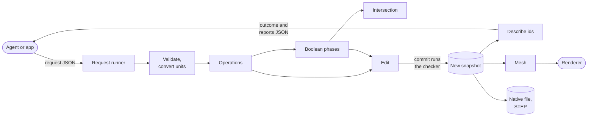

# Architecture

**Status: proposed, for the user's approval** (the exit gate of [`proving-ground`](plan/proving-ground.md)).

The design of occam's first release. This page is the map; each topic page has a diagram, and links down to its type
sketch and evidence.

> **Waiting on you:** four questions, on [one page](architecture/open-decisions.md).

## How a request moves through it

## Topics

| | Topic | In one line |
|---|---|---|
| **Start** | [**Open decisions**](architecture/open-decisions.md) | Four questions for you |
| | [Crates](architecture/crates.md) | The layers |
| | [The bracket test](architecture/bracket-test.md) | The acceptance test, step by step |
| **Foundations** | [Units](architecture/units.md) | Typed quantities, one tolerance per model |
| | [Maths](architecture/maths.md) | Lanes, and decisions that can say "undecided" |
| | [Threads and lanes](architecture/threads-and-lanes.md) | Parallel maps, results in index order |
| | [Determinism](architecture/determinism.md) | Same bits on any thread count or target |
| **Model** | [Geometry](architecture/geometry.md) | Curves and surfaces |
| | [Topology](architecture/topology.md) | Entities, ids, snapshots, the edit, names and colours |
| **Algorithms** | [Intersection](architecture/intersection.md) | Closed forms, then a hybrid |
| | [Operations](architecture/operations.md) | Requests as data, one result per item |
| | [The boolean](architecture/boolean.md) | Seven pure phases |
| **Outputs** | [Reports](architecture/reports.md) | What an agent reads |
| | [Mesh and renderer](architecture/mesh-and-renderer.md) | Edges, then faces, then a watertight check |
| | [Browser](architecture/browser.md) | One editing worker, several mesh workers |
| | [Files](architecture/files.md) | JSON native format, STEP export |
| | [Command line](architecture/command-line.md) | What the agent can call |
| **Doubts** | [Risks](architecture/risks.md) | What would prove it wrong |

## The stance

- **Simplest design that passes [the bracket test](architecture/bracket-test.md).** Structure only where a spike found
  a case that needed it; batch paths only where one measured a gain.
- **Layouts behind interfaces,** so struct-of-arrays, grouped geometry or caching can arrive later in one module.

## Where it came from

Two proposals with opposite emphases, and a critic on each (L50): [A](evidence/2026-11-10-design-a.md)
([critique](evidence/2026-11-10-design-a-critique.md)) and [B](evidence/2026-11-10-design-b.md)
([critique](evidence/2026-11-10-design-b-critique.md)). "A:3" means point 3 of A's critique. S1 to S6 and P1 to P12 are
the [spike findings](evidence/README.md). The crate list `gates layers` reads is [§4 of the plan](PLAN.md#4-layers);
the signatures are in [the type sketch](sketch/src/lib.rs) (`just sketch`).
