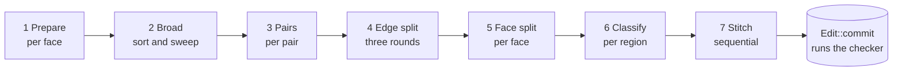
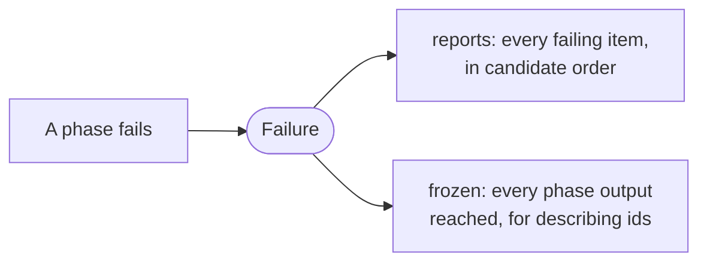

# The boolean

[Architecture](../ARCHITECTURE.md) › [Operations](operations.md) › The boolean · sketch [`ops.rs`](../sketch/src/ops.rs)

Fuse, cut and common, as seven pure phases. Each phase maps frozen input to frozen output. Only the last one touches the
model.

| Phase | What it does |
|---|---|
| 1 Prepare | Only faces whose bounds meet the other operand. The rest keep their ids |
| 2 Broad | Candidate face pairs from a sort and sweep over conservative boxes, in stable order |
| 3 Pairs | One [section](intersection.md) per distinct surface pair; an edge against a face only after its box test |
| 4 Edge split | Stops per edge, then pinch vertices merged, then the clips, with the vertex table frozen between rounds |
| 5 Face split | One face a task |
| 6 Classify | One region a task, then propagation to the untouched faces |
| 7 Stitch | Sequential: the only phase that gives ids |

- **A phase is a pure function of content.** Its output holds indices local to each item, never a model id. So a cache
  could be added later without changing a phase. There is no cache in the first release.

## On failure

The first report is the primary one, because a long list can distract an agent (S6). The input model is unchanged.

Evidence

- [P2](../evidence/2026-11-09-p2.md): pure phases gave identical output at every thread count and reported every
  failing pair, where a shared graph gave 4 different digests at six threads. S1 mutated the vertex table while it
  clipped; freezing it between rounds is the change that made output identical.
- [P1](../evidence/2026-11-09-p1.md): preparing only touched faces keeps work following the edit. All-pairs grows
  quadratically and must change before models get large (also [P8](../evidence/2026-11-09-p8.md)).
- [P8](../evidence/2026-11-09-p8.md): a cache saves almost nothing once order is explicit and edges are box-tested,
  except on NURBS marching. Local indices are P8's rule for later reuse; items name failures in local terms and the
  merge maps them to ids (B:4).

