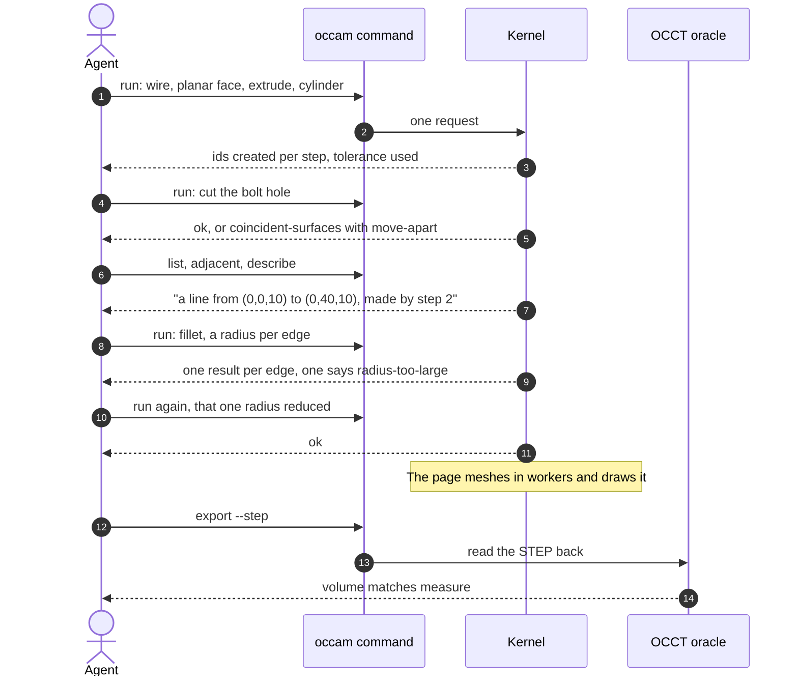

# The bracket test, walked

[Architecture](../ARCHITECTURE.md) › The bracket test

The first release's acceptance test: an agent with only the `occam` command builds a bracket, fillets it, views it and
exports it.

| Step | What happens | Where |
|---|---|---|
| Build the plate | Wire through the profile, planar face, extrude, a cylinder for the hole, in one request | [Operations](operations.md) |
| Cut the hole | A boolean cut. A tool exactly as tall as the plate has coplanar caps: until coincident surfaces land, that is `boolean.coincident-surfaces` with `move-apart` | [The boolean](boolean.md) |
| Choose edges | `list`, `adjacent` and `describe`, by id, with provenance | [Command line](command-line.md), [reports](reports.md) |
| Fillet | A radius per edge. One result per edge; the bad one gets `reduce-radius { edge, radius }`, the largest certified radius | [Operations](operations.md#fillets) |
| View | The editing worker publishes the model; mesh workers mesh face ranges; per-face buffers | [Browser](browser.md), [mesh](mesh-and-renderer.md) |
| Export and check | STEP written; the oracle reads it back and its volume matches `measure`'s | [Files](files.md) |
