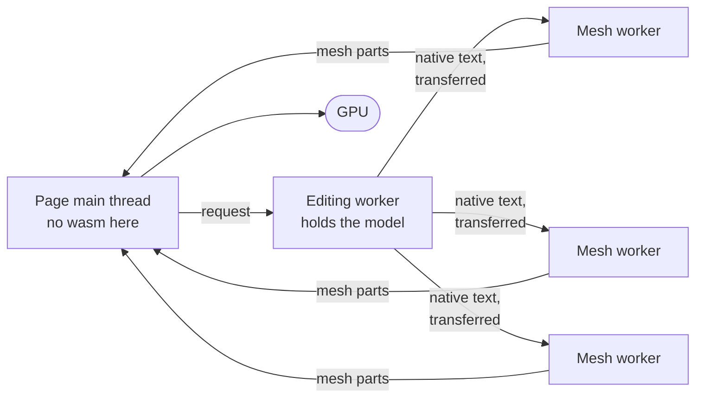

# Browser

[Architecture](../ARCHITECTURE.md) › Browser · sketch [`compose.rs`](../sketch/src/compose.rs), `Session`

The kernel in the browser: workers with separate memories, on stable Rust, simd128 by default, and nothing required of
the hosting page (O18).

- **One editing worker** holds the model and runs requests. After each edit it publishes the model as native text.
- **Mesh workers** load that text read-only and mesh ranges of faces, about 64 calls a job.
- **No wasm runs on the page's main thread.**
- **Each call's output is deterministic.** The page's assembly of the parts is display-only, like GPU output.
- **An edit is one long call** on its worker. Splitting a boolean across calls waits for the `view` milestone's timing.

Evidence

- [P10](../evidence/2026-11-09-p10.md): the worker pool. About 64 calls a job balanced uneven work and avoided
  Firefox's long-call penalty of 1.4 to 2.3×.
- Assembly as display-only: B:12. Shared-memory threads instead would need nightly and an adapter dependency
  ([O18](open-decisions.md#assumed-answers-no-question)).

