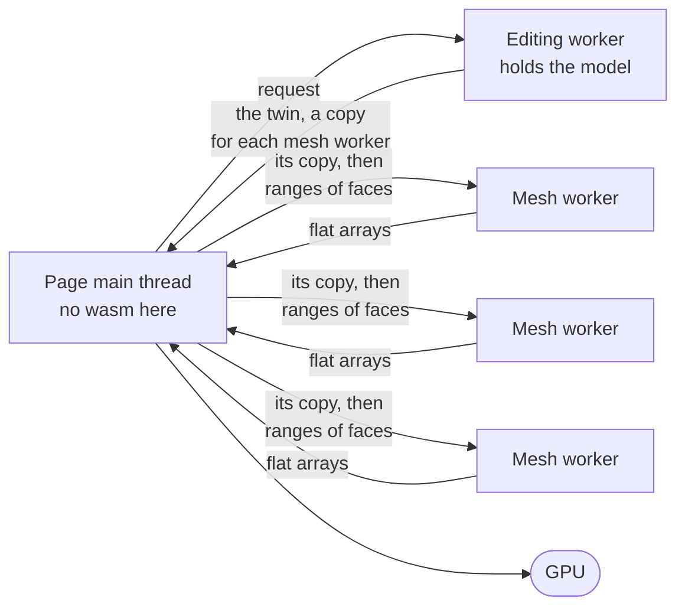

# Browser

[Architecture](../ARCHITECTURE.md) › Browser · crate `occam-wasm`, `Session` · page `web/`, its workers

The kernel in the browser: workers with separate memories, on stable Rust, simd128 by default, and nothing required of
the hosting page (O18).

- **One editing worker** holds the model, in a `Session`, and runs requests in the order they come. A request that
  goes through and changes the model gives the model as native bytes, the binary twin, which the worker publishes as
  one copy for each mesh worker. Each copy is an `ArrayBuffer`, which skips the UTF-16 conversion a JavaScript string
  needs at both ends, and the page passes it on without copying it.
- **Mesh workers,** kept alive between requests, each open their own copy read-only and mesh ranges of faces
  (`Session.mesh_part`). The page cuts a model's faces into about 64 ranges of one size and deals them out one at a
  time to whichever worker is free. Each range's arrays are numbered from their own start, and its edges are sampled
  as the whole mesh samples them, so the ranges laid end to end in id order are the buffers `occam mesh` gives, bit
  for bit. Each range is checked watertight as far as it reaches.
- **No wasm runs on the page's main thread.** Only the workers fetch the kernel's module, `occam.wasm`, built with
  simd128.
- **Nothing is shared,** so the page needs no `SharedArrayBuffer`, and no COOP or COEP headers: bytes and arrays are
  transferred.
- **Each call's output is deterministic.** The page's assembly of the parts is display-only, like GPU output.
- **A face that will not mesh is named** in the page by the kernel's report, and the rest of the model is drawn.
- **An edit is one long call** on its worker. Splitting a boolean across calls waits for the `view` milestone's timing.

| Message | From, to | What it carries |
|---|---|---|
| `run` | page, editing worker | the request, and how many copies of the twin to make |
| `ran` | editing worker, page | the run's one JSON form, the model's face count, and the copies, if it changed |
| `load` | page, mesh worker | a model's number and its own copy of the twin |
| `mesh` | page, mesh worker | a call's number, the model's, the limits, and the range of faces |
| `meshed` or `failed` | mesh worker, page | the range's arrays and faces' table, with the reports refusing any of it; or why it could not mesh at all |

[`web/src/protocol.ts`](../../web/src/protocol.ts) declares them.

Evidence

- [P10](../evidence/2026-11-09-p10.md): the worker pool. About 64 calls a job balanced uneven work and avoided
  Firefox's long-call penalty of 1.4 to 2.3×.
- Assembly as display-only: B:12. Shared-memory threads instead would need nightly and an adapter dependency
  ([O18](open-decisions.md#assumed-answers-no-question)).

