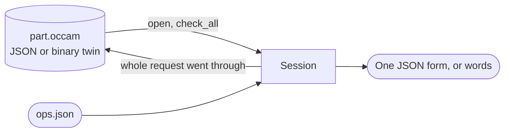

# Command line

[Architecture](../ARCHITECTURE.md) › Command line · crate `occam-cli`

The bracket test's agent has only the `occam` command and its reports. Every command takes `--json`, takes many ids,
and gives one result per id. `occam --help`, and `--help` after any command, say what each takes
([clap](../decisions/2026-11-13-clap.md) writes them).

| Command | What it does |
|---|---|
| `occam run --model part.occam ops.json` | Runs a [request](operations.md) and writes the model back |
| `occam list --model part.occam --kind edge,face` | Lists every live entity of each kind, in slot order |
| `occam adjacent --model part.occam edge:41/1` | Lists each entity's neighbours |
| `occam describe --model part.occam edge:41/1 face:5/1` | Describes entities, with the [one resolver](reports.md#how-an-agent-learns-what-an-entity-is) |
| `occam check --model part.occam` | Checks the whole model |
| `occam mesh` | Meshes the model (`view`) |
| `occam export --step` | Writes STEP (`exchange`) |

- **A step's outcome** lists what it created, changed and deleted, by id.
- **`run` is the whole request or nothing.** The model is written back only if every step went through, so a request
  that stopped short can be mended and run again on the same file. A missing file is a new model. A model keeps its
  encoding; a new one is the readable JSON, or the [binary twin](files.md) with `--binary`. A model the format cannot
  write yet is not written, and the run says so with `io.not-saved`.
- **`check` opens the model,** which measures every edge and checks the whole model as `commit` does, so a model
  that opens is sound.
- **One answer per id.** An id that names nothing is `topo.stale-id` for that id alone, and the others are answered.
- **The JSON form** of `list`, `adjacent`, `describe` and `check` is `{"schema", "ok", "answers", "reports"}`: an answer
  per id or kind, each with the report refusing it if it has none, and the reports that refused the command whole or
  that the check found. `run` gives the run's own form.
- **In words,** answers go to standard output and refusals to standard error.
- **The exit status** is 0 when everything asked was answered, 1 when anything was refused, and 2 when the command line
  is wrong (`cli.bad-argument`, naming the argument, what was given and what was wanted).
