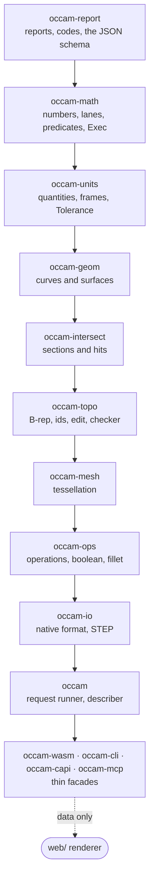

# Crates

[Architecture](../ARCHITECTURE.md) › Crates

Each crate may use only the crates above it. The list `gates layers` checks is [§4 of the plan](../PLAN.md#4-layers);
this page explains it.

`occam-verify` and `occam-xtask` hold the oracles, corpus and gates. They are never published.

## What moved since the provisional list

| Change | Why |
|---|---|
| `occam-check` became a module of `occam-topo` | The checker runs inside `Edit::commit`, the only way to make a snapshot, so no unchecked model can exist |
| The execution layer (`Exec`) lives in `occam-math` | Both crates that can touch bits (`rayon`, `fearless_simd`) sit in the one crate `gates determinism` already builds at 1 and N threads |
| Intervals, expansions and exact predicates go in `occam-math` | They are numbers only, and [the maths choke point decision](../decisions/2026-11-09-one-maths-choke-point.md) puts all computing there |
| `Tolerance` stays in `occam-units`, with S2's meaning | See [units](units.md#tolerance) |
| Geometry codes join the one catalogue in `occam-report` | A description is plain data there, so the crate still depends on nothing of occam's |
| `occam` gains the request runner and the describer | See [reports](reports.md#how-an-agent-learns-what-an-entity-is) |

Evidence and alternatives

- A separate `occam-exec` crate (proposal A) would have put the threading runtime under the numbers crate for one test
  (A:9). A's `Verifier` trait, the alternative to a checker inside `commit`, needed a source gate to stay honest.
- `rayon` is named only by `Exec`, and `fearless_simd` only by `Level` and `dispatch`:
  [the rayon decision](../decisions/2026-11-10-rayon.md),
  [the fearless_simd decision](../decisions/2026-11-10-fearless-simd.md).

