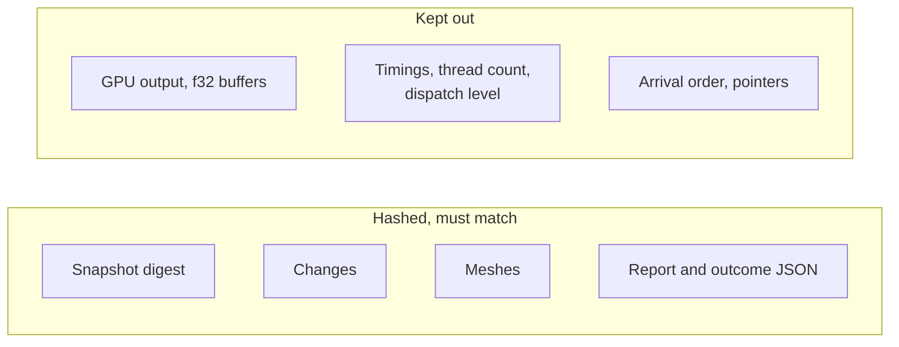

# Determinism

[Architecture](../ARCHITECTURE.md) › Determinism · contract [`DETERMINISM.md`](../DETERMINISM.md)

The same input gives the same bits at 1 or N threads, on x86-64 and wasm32 (baseline and simd128), at every dispatch
level. This page says where the design keeps that promise.

## The rules

- **Order is item index everywhere.** `Exec::map` returns by index, chunk boundaries depend on chunk size alone, merges
  run in candidate order, tables iterate in slot order.
- **A pair is put in canonical order** by family, batch key and content, so argument order cannot change the answer.
- **Ids are given only in `Edit`,** on one thread, in plan order, lowest free slot first. Phases use indices local to
  an item.
- **Content, never pointers.** `Arc::ptr_eq` and `std::ptr::eq` are banned in kernel crates.
- **A computed value is never compared with exactly zero** (rule 4): it uses the band, or a predicate on exact inputs.
  - A point within the band of a periodic seam belongs to the chart the face's sheet names.
  - A count taken from a computed value uses its interval's upper end, so it always rounds the same way.

A snapshot's digest covers every live record in slot order, every geometry's content and the tolerance, with NaNs made
canonical.

## The gate grows by milestone

`gates determinism` gains the owned functions (hashed against a separate implementation), the filter, `Exec::map` and
`dispatch` in `maths`, then corpus booleans and meshes as they arrive. S5's four statements join
[`DETERMINISM.md`](../DETERMINISM.md) in the `maths` milestone.

Evidence

- [P8](../evidence/2026-11-09-p8.md): a cached curve took a slower path because pointer identity said "different" where
  content was equal, hence the pointer ban.
- [S5](../evidence/2026-11-09-s5.md): rule 4 and the owned functions.
- [P2](../evidence/2026-11-09-p2.md): candidate-order merges gave identical output at every thread count.

