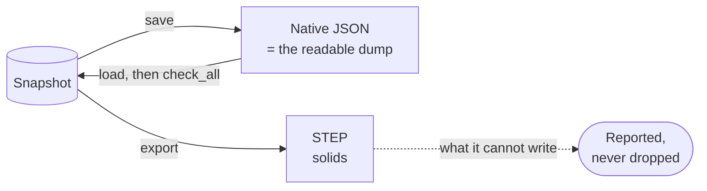

# Files

[Architecture](../ARCHITECTURE.md) › Files · crate `occam-io` · sketch [`io.rs`](../sketch/src/io.rs)

One native format, which is also the readable dump. STEP for exchange.

- **The records as JSON,** with every finite number round-tripping exactly.
- **Versioned from the first commit.** It holds the tolerance, the step counter and every slot's generation, so a loaded
  model has the same ids and digest as the saved one.
- **Loading checks the whole model.** Nothing from outside is trusted.
- **STEP export** writes solids. Import comes in the `exchange` milestone (PARITY 2.9).
- **Load time is a risk:** a binary encoding is added if the `construction` exit measures JSON too slow
  ([risks](risks.md)).

Evidence

- One format, not two: PARITY 2.17 and L8. `serde_json` with `float_roundtrip`. STEP export reporting what it cannot
  write: PARITY 1.9.

