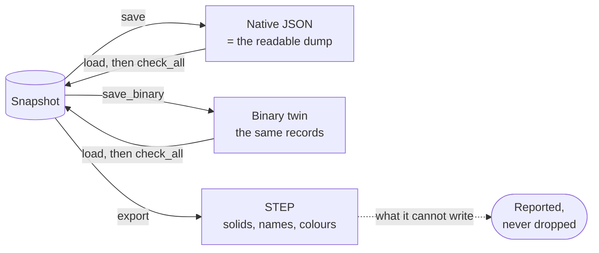

# Files

[Architecture](../ARCHITECTURE.md) › Files · crate `occam-io` · sketch [`io.rs`](../sketch/src/io.rs)

One native format, whose JSON is also the readable dump and which has a binary twin for loading fast. STEP for
exchange.

- **The records, with their [names and colours](topology.md#names-and-colours), as JSON.** Every finite number
  round-trips exactly.
- **Curves and surfaces as their family's name and the numbers that define them,** the numbers their content holds,
  so each family restores itself bit for bit and refuses what none of its constructors makes. A family the format does
  not write yet is refused at save, by name, never dropped.
- **Versioned from the first commit.** It holds the tolerance, the step counter and every slot's generation, so a loaded
  model has the same ids and digest as the saved one.
- **Loading checks the whole model.** Nothing from outside is trusted.
- **Bytes at the seam, not text.** `save` and `save_binary` give `Vec<u8>`, and `load` takes `&[u8]` in either
  encoding, telling them apart by the twin's magic.
- **The binary twin** holds the same records, under the same version, in `postcard`'s encoding, links as their kind,
  slot and generation and numbers as their eight bytes. It is refused for whatever the JSON would be refused for, with
  the same codes ([the decision](../decisions/2026-11-12-binary-twin.md)). It ends with a CRC-32 of the rest, checked
  before the records are read, and its reader is tested against files made to break it
  ([the checksum decision](../decisions/2026-11-13-binary-twin-checksum.md)).
- **STEP export** writes solids with their names and colours. Import comes in the `exchange` milestone and keeps them
  (PARITY 2.9).
- **Load time is a risk** ([risks](risks.md)). Parsing 10⁵ faces from JSON took 1.445 s, over the risk's second, so
  the format gained its binary twin. The exit times parsing and `check_all` apart, because the twin speeds up only the
  first.

Evidence

- One format, not two: PARITY 2.17 and L8. The twin is the same format in another encoding, not a second one.
  `serde_json` with `float_roundtrip`, and `postcard` for the twin. STEP export reporting what it cannot
  write: PARITY 1.9.

