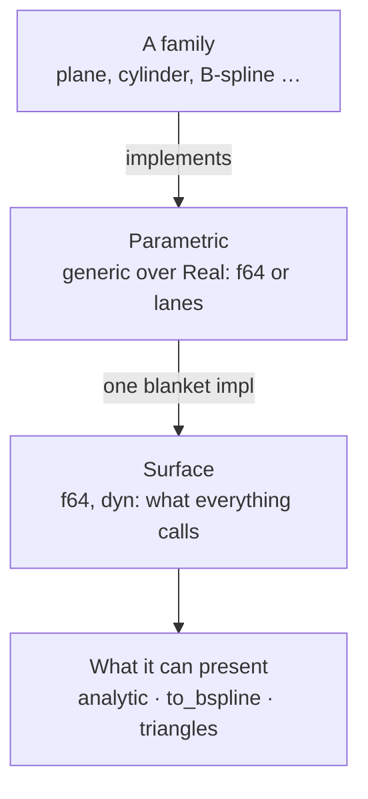

# Geometry

[Architecture](../ARCHITECTURE.md) › Geometry · crate `occam-geom` · sketch [`geom.rs`](../sketch/src/geom.rs)

Curves and surfaces. A family implements one trait; everything else calls another. All stored geometry is in `World`.

Curves repeat both layers as `ParametricCurve` and `Curve`, and parameter curves on a surface as
`ParametricParamCurve` and `ParamCurve`. The
blanket impl is also where a call is checked: a parameter outside the domain, or a point that is not finite, is refused
there, so no family repeats it. A curve answers the same questions over one parameter, `closest` included, and can be
trimmed by parameter; where no formula gives a foot, a search shared by every family finds it. A curve's rungs run to
the second, `eval_second`, which a surface swept from it reads in lanes.

## What a surface answers

| Method | What for |
|---|---|
| `eval_point`, `eval_first`, `eval_second` | The hot paths. Nothing beyond the order asked for is computed; an undefined parameter gives NaN |
| `derivatives(uv, order)` | Every partial derivative to any order, exact where the family can be (PARITY 2.1, 2.2, O21) |
| `highest_derivative` | `None` for every order; a mesh's is 1. An order above it is refused, and its rungs are NaN |
| `eval_batch(uv, order, out, scratch, level)` | One surface at many points. The caller owns outputs and scratch, so nothing allocates once they have grown. A bit per point in `out`: defined or not |
| `invert`, `closest` | A foot's parameters; the full closest-point solve, by default the point at `invert`'s parameters. Both report where the solver stopped |
| `domain`, `bounds(patch)`, `degeneracies` | Each parameter's kind; a conservative box; poles and apexes, declared at construction |
| `family`, `batch_key`, `content` | For sorting calls and ordering pairs. `content` is the canonical bits, never a pointer |
| `shape` | The form name and parameters a [description](reports.md) shows |
| `analytic`, `to_bspline(patch)`, `triangles` | What it can present. Each defaults to nothing, so a new family edits no list. A B-spline is [over a patch](../decisions/2026-11-11-to-bspline-over-a-range.md), never an unbounded one |

## The families

The ones [PARITY](../PARITY.md) places in `geometry`. Curves: lines, circles, conics, B-spline and Bézier, offset and
trimmed. Surfaces: plane, cylinder, cone, sphere, torus, B-spline and Bézier, revolution, linear extrusion, offset and
trimmed. Parameter curves of the same kinds. Plus **mesh-backed surfaces**, because the `geometry` exit proves its seam
on three families before it freezes (L21).

## Splines in lanes

A B-spline family evaluates a batch in lanes where its points share a knot span, as a tessellator's grid does: the
span's knots and poles are read once for every lane. Where a chunk of points crosses a span, each lane is evaluated
alone, so every lane keeps the bits of a single call. On baseline x86-64 this takes 49% of width 1's instructions,
where S4, gathering a span per lane, found no gain. The basis's arrays are on the stack, sized by the degree that
needs them, up to degree 25.

## Mesh-backed surfaces

Each vertex has a point and a place in the parameters, as in S4. A parameter in a triangle gives that triangle's
point, so the surface is continuous and has its first derivatives alone, and the suite stops there for it. A parameter
in no triangle is a hole, undefined, and a batch says which. A grid over the parameters finds the triangle, and two
triangles on an edge decide its side with one computation, so no point falls between them. The foot is the nearest
point of any triangle, by a scan, as S4's was. Lanes run one at a time, as S4 measured no gain.

## Swept surfaces

A surface of revolution or of linear extrusion holds its curve by type, `Revolution<C>` and `Extrusion<C>`, so the
curve's rungs run in lanes inside the surface's, and every curve family can be swept. A revolution's partial derivative
`i` times in the angle and `j` in the curve's parameter turns the curve's `j`-th derivative across the axis by `i`
quarter turns, as the analytic surfaces turned about an axis do. Each foot reduces exactly to one parameter, a
revolution's to its meridian's and an extrusion's to its curve seen along the direction, and the curves' shared search
finds every valley of one parameter, even where a revolution passes through itself, which a grid over two parameters
can miss. A revolution declares a degenerate line only where an end of the curve lies on the axis, and never guesses at
a crossing.

A swept curve may run without end, [as the user decided](../decisions/2026-11-12-unbounded-sweeps.md), and the
surface's parameter then does too. The search still runs over a finite window: a curve family says, through `within`,
which of its parameters come within a distance of a point, or of a line along a direction, and the curve's own foot of
the point bounds that distance. Turning about an axis keeps distance from it, so a revolution asks about a ball about
the axis; an extrusion asks about the line through the point along its direction. A curve that runs along the
direction without end has no such window, and is refused (`geom.swept-along-itself`): a line along its own direction,
which sweeps no surface, and a hyperbola along an asymptote, which sweeps a half-plane whose edge is at infinity, where
the curve's points are rounding long before the search could near it.

## Offset and trimmed

An offset `S + d N` and a trimmed surface or curve hold what they wrap by type, `OffsetSurface<S>`, `OffsetCurve<C>`,
`TrimmedSurface<S>` and `TrimmedCurve<C>`, so the base's rungs run in lanes inside theirs and any family can be
wrapped, offsets and trims included.

The offset's partials to an order need the base's to the order above, through the unit normal's. Those come exactly, to
any order, from do Carmo's Gauss map written as products: `M = Su x Sv` by Leibniz's rule, its length `r` from
`r r = M . M`, and `N = M / r` divided as a rational spline is by its weight. So an offset has one order fewer than its
base, and a base without second derivatives, a mesh, has no continuous normal and is refused (`geom.not-smooth`). Its
second rung needs the base's third derivatives, which no rung gives, so it runs a lane at a time through
`derivatives`. Where `Su x Sv` vanishes the offset is undefined; a degenerate line that declares its normal, as a
sphere's pole, moves along it and stays declared. A curve's offset is `C + d (C' x V) / |C' x V|` for a reference
direction `V`: in a plane square to `V`, to its right as it runs where `d` is above zero.

An offset presents its base's form where that stays a form: a plane moved, and a cylinder, a sphere and a torus's tube
grown while above zero and facing as before. A cone's two nappes move to two cones, and a form shrunk through its axis
faces inward, which no form says, so neither is presented. Its B-spline is the base's under the affine map the offset
is for a plane, a sphere and a cylinder; elsewhere it has none. Its foot starts from the base's, which is the offset's
wherever the distance is within the base's radii of curvature on that side, and over a finite domain the shared search
from there finds it where it is not. A trimmed family's foot is the base's where that lies in the trimmed part, and
otherwise is searched for there.

## Parameter curves

A curve in a face's parameters is any curve family drawn in the plane `z = 0` and read as `(u, v) = (x, y)`:
`UvCurve<C>`. The reading is a linear map, so points, derivatives to any order, boxes, B-splines, and the family's
window for a search (its `within`, asked about the line through the point square to the plane) carry over exactly, and
a line, circle, conic, B-spline, offset or trimmed curve in the parameters is that family, with no second copy of its
formulas, its shape and content the parameter curve's. A curve that leaves the plane is refused with
`geom.not-in-plane` and how far it reaches, decided by its own box, which holds it, over its range or a stretch of a
range without end: otherwise a tilted circle would read as an ellipse that said it was a circle. The parameters are
plain numbers here: one millimetre of the plane is one unit of each parameter, a radian, a millimetre or a knot, and a
distance or a fit between parameters is in their own measure. The curve suite runs over a parameter curve unchanged,
through an exact embedding of it in the plane.

`join_edge` joins a parameter curve to its edge's curve in space. They agree when the surface over the one runs along
the other within the band the same way: starts meet, ends meet, and samples of each have a foot on the other within
the band, found along each, so their parameterisations may differ. Otherwise it reports `geom.edge-off-surface` with
the largest gap, where it is, and the edge's parameter there. A parameter curve may cross a seam, as an arc on a
cylinder whose `u` runs past 2π does: a parameter that comes round is defined at every finite value, and the check
compares points in space, where a seam is no edge.

## No cross-family store

Calls are **sorted** by family and degree; geometry is **stored** one item a slot, in the snapshot's tables. Grouping
storage by family would save 15% of surface memory, and waits until memory asks
([O23](open-decisions.md#o23-the-wording-of-l29)).

Evidence

- [P8](../evidence/2026-11-09-p8.md) item 1: computing derivatives nobody asked for was 33 to 34% of whole-run time.
  `invert` without derivatives is half of a point query; it is required so no family inherits the full solve (B:13).
- [P9](../evidence/2026-11-09-p9.md): one surface at many points is 1.8 to 3.3× on analytic surfaces. It is the shape of
  P1's sampling, P9's refinement and P12's dirty rectangles.
- [S4](../evidence/2026-11-09-s4.md): degree 5 by 4 allocated on every call, hence the caller's scratch. Sorting calls by
  kind is worth 14 to 18%. Homogeneous data cannot be recovered from `dyn Surface` without a downcast. S4's one store
  was 2.6× slower on analytic surfaces, a figure S4 warns measures its implementation. A frame parameter on the traits
  caused E0119, hence everything in `World`; instancing in a local frame is a later, placed family.
- [S3-P3](../evidence/2026-11-09-s3-p3.md): no lane gain on baseline x86-64; grouping saves 15% of surface memory.
  [P5](../evidence/2026-11-09-p5.md): batching is worth under 3% of intersection (A:1).
- `shape`'s form is text held to the catalogue's list by a test, so a new family edits no enum in `occam-report` (B:4).
  Proposal B dropped mesh-backed surfaces without asking, a change of scope (B:6).

