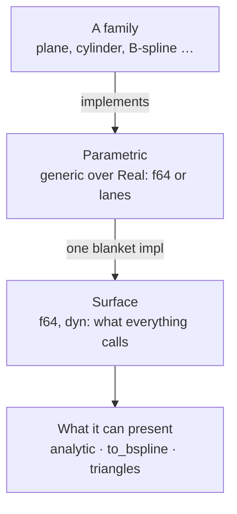

# Geometry

[Architecture](../ARCHITECTURE.md) › Geometry · crate `occam-geom` · sketch [`geom.rs`](../sketch/src/geom.rs)

Curves and surfaces. A family implements one trait; everything else calls another. All stored geometry is in `World`.

Curves repeat both layers as `ParametricCurve` and `Curve`, and parameter curves on a surface as `ParamCurve`. The
blanket impl is also where a call is checked: a parameter outside the domain, or a point that is not finite, is refused
there, so no family repeats it. A curve answers the same questions over one parameter, `closest` included, and can be
trimmed by parameter; where no formula gives a foot, a search shared by every family finds it.

## What a surface answers

| Method | What for |
|---|---|
| `eval_point`, `eval_first`, `eval_second` | The hot paths. Nothing beyond the order asked for is computed; an undefined parameter gives NaN |
| `derivatives(uv, order)` | Every partial derivative to any order, exact where the family can be (PARITY 2.1, 2.2, O21) |
| `eval_batch(uv, order, out, scratch, level)` | One surface at many points. The caller owns outputs and scratch, so nothing allocates once they have grown. A bit per point in `out`: defined or not |
| `invert`, `closest` | A foot's parameters; the full closest-point solve, by default the point at `invert`'s parameters. Both report where the solver stopped |
| `domain`, `bounds(patch)`, `degeneracies` | Each parameter's kind; a conservative box; poles and apexes, declared at construction |
| `family`, `batch_key`, `content` | For sorting calls and ordering pairs. `content` is the canonical bits, never a pointer |
| `shape` | The form name and parameters a [description](reports.md) shows |
| `analytic`, `to_bspline(patch)`, `triangles` | What it can present. Each defaults to nothing, so a new family edits no list. A B-spline is [over a patch](../decisions/2026-11-11-to-bspline-over-a-range.md), never an unbounded one |

## The families

The ones [PARITY](../PARITY.md) places in `geometry`. Curves: lines, circles, conics, B-spline and Bézier, offset and
trimmed. Surfaces: plane, cylinder, cone, sphere, torus, B-spline and Bézier, revolution, linear extrusion, offset and
trimmed. Parameter curves of the same kinds. Plus **mesh-backed surfaces**, because the `geometry` exit proves its seam
on three families before it freezes (L21).

## Splines in lanes

A B-spline family evaluates a batch in lanes where its points share a knot span, as a tessellator's grid does: the
span's knots and poles are read once for every lane. Where a chunk of points crosses a span, each lane is evaluated
alone, so every lane keeps the bits of a single call. On baseline x86-64 this takes 49% of width 1's instructions,
where S4, gathering a span per lane, found no gain. The basis's arrays are on the stack, sized by the degree that
needs them, up to degree 25.

## No cross-family store

Calls are **sorted** by family and degree; geometry is **stored** one item a slot, in the snapshot's tables. Grouping
storage by family would save 15% of surface memory, and waits until memory asks
([O23](open-decisions.md#o23-the-wording-of-l29)).

Evidence

- [P8](../evidence/2026-11-09-p8.md) item 1: computing derivatives nobody asked for was 33 to 34% of whole-run time.
  `invert` without derivatives is half of a point query; it is required so no family inherits the full solve (B:13).
- [P9](../evidence/2026-11-09-p9.md): one surface at many points is 1.8 to 3.3× on analytic surfaces. It is the shape of
  P1's sampling, P9's refinement and P12's dirty rectangles.
- [S4](../evidence/2026-11-09-s4.md): degree 5 by 4 allocated on every call, hence the caller's scratch. Sorting calls by
  kind is worth 14 to 18%. Homogeneous data cannot be recovered from `dyn Surface` without a downcast. S4's one store
  was 2.6× slower on analytic surfaces, a figure S4 warns measures its implementation. A frame parameter on the traits
  caused E0119, hence everything in `World`; instancing in a local frame is a later, placed family.
- [S3-P3](../evidence/2026-11-09-s3-p3.md): no lane gain on baseline x86-64; grouping saves 15% of surface memory.
  [P5](../evidence/2026-11-09-p5.md): batching is worth under 3% of intersection (A:1).
- `shape`'s form is text held to the catalogue's list by a test, so a new family edits no enum in `occam-report` (B:4).
  Proposal B dropped mesh-backed surfaces without asking, a change of scope (B:6).

