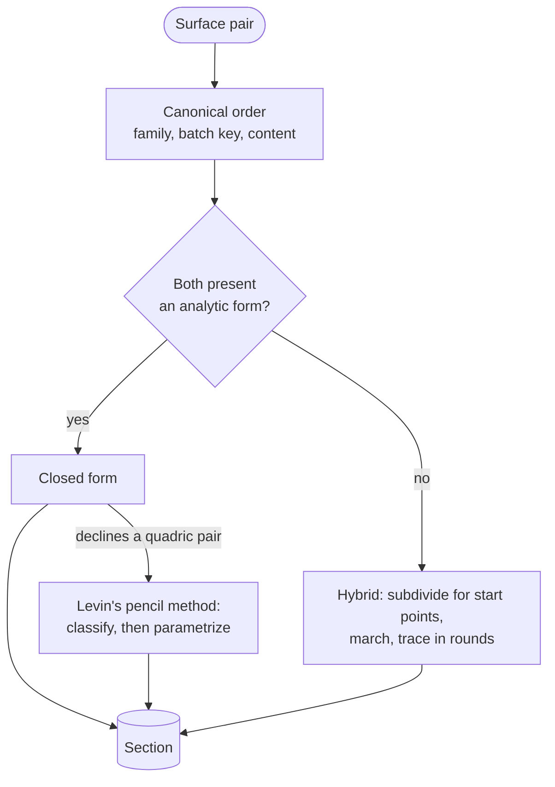
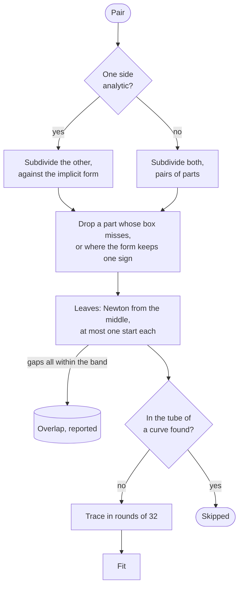
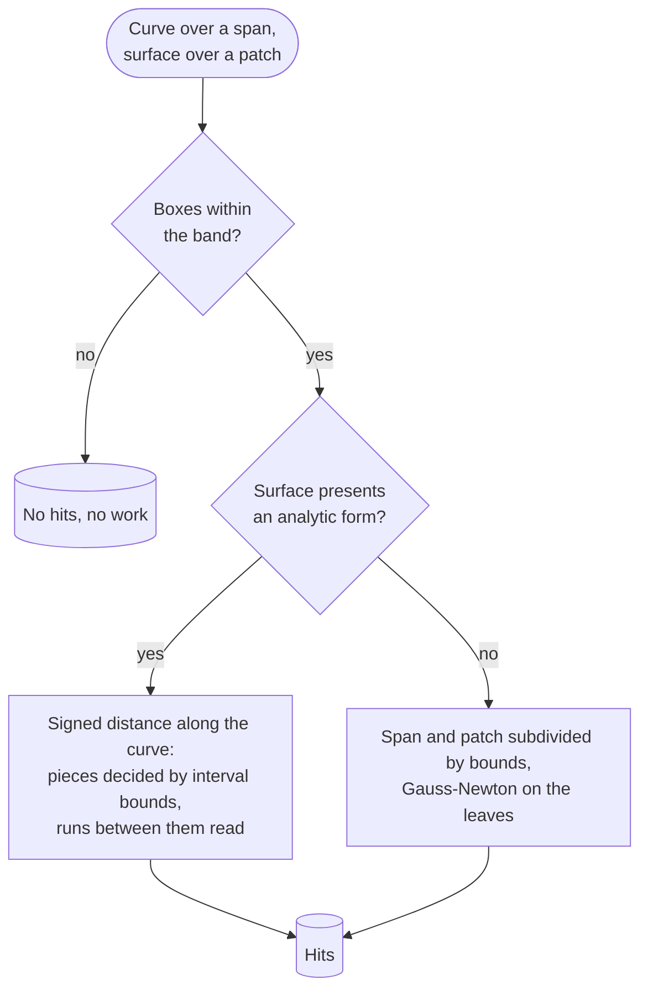

# Intersection

[Architecture](../ARCHITECTURE.md) › Intersection · crate [`occam-intersect`](../../crates/occam-intersect/src/lib.rs) · sketch [`intersect.rs`](../sketch/src/intersect.rs)

Where two surfaces meet, and where an edge crosses a surface. An ordered list of methods; what failed stays beside
what was found.

## Surface against surface

| A `Section` holds | Meaning |
|---|---|
| curves | Each with its image on both surfaces |
| contacts | A point of tangency, or `BelowResolution`: a contact or loop smaller than this tolerance can tell apart (O24) |
| coincidence | Coplanar or coaxial (O25) |
| failures | A stalled trace, a spent budget, an unresolved leaf, an undecided predicate |
| tally | The decisions made, from [maths](maths.md#robust-decisions) |

- **Canonical order** means swapping the arguments cannot change the answer.
- **A closed form's images** are its curve read through each surface's [chart](geometry.md#parameter-curves), the
  closed form of its parameters. A surface without one, such as a plane's B-spline with uneven poles, declines to the
  next method.
- **The pencil method** answers two of a sphere, a cylinder and a cone that the closed forms leave. It classifies the
  pencil by the real roots of its determinant, their multiplicities and the members' ranks there, each decided against
  the band through predicates on the matrices' entries. No multiple root is a smooth quartic, in `Quartic` loops; a
  double root of rank three with its vertex on both surfaces a nodal quartic, or a triple one a cusp, a rational
  B-spline from its vertex; a double root of rank two a split into the conics of its pair of planes, which may cross
  where no point is real. A determinant zero for every member is two cones with one apex, meeting in rulings, or a
  cylinder tangent to a cone along a ruling, which splits into that ruling and a conic. Singular points are contacts. A
  degenerate pencil of any other kind is reported as not implemented, never fitted, and a decision the band cannot make
  is `decide.undecided`. Its curves' images count their turns about each chart's axis.
- **A section that reaches infinity** is given within an extent the caller passes, `Pencil::within(box)`, since
  `booleans` meets only bounded faces. Two cones that share a ruling direction meet in a quartic that runs to infinity
  along it. A cylinder along a cone's ruling direction meets it in a quartic with its node at infinity, and, through the
  cone's apex, in that ruling and a cubic. The quartic comes in `Quartic` pieces, and the rational curves in rational
  B-splines, one point on each ruling, each cut where it leaves a ball just round the box. Lines stay whole, as the
  closed forms give them.
- **The hybrid needs no B-spline form,** so offsets and mesh-backed surfaces reach it: it subdivides by `bounds` alone,
  which for a B-spline is the hull of the part's own poles and so goes on shrinking inside a knot span.
- **Many pairs** run one pair a task, one result each, in pair order, and a method's own work, the hybrid's leaves,
  traces and fits, runs through the same `Exec` (`Method::attempt_shared`), with the same bits.
- **Traced points become curves** through [`fit`](../../crates/occam-intersect/src/fit.rs): B-splines through a trace's
  stations, with images through the same stations' parameters, cut where a surface's parameters jump and refined until
  twice every gap between a curve and a surface's point at its image is within the band. The fit is recorded on the
  curve and on each image; one that cannot reach the band is `intersect.fit-outside-band`, and its curve is kept.

### The hybrid

- **Breadth first,** a level at a time, each part halved across its wider side until its box is a leaf across. A part
  is dropped when its box misses the other's by more than the band, or, against an analytic side, when the implicit
  function's size at the box's middle less the box's half diagonal is above the band (P8). Each is a band decision.
- **A leaf** gives at most one start point, where Newton's method from its middle settles inside it. A leaf where the
  surfaces are within the band of each other at its middle and corners is an overlap, such as a rational cylinder on
  its analytic twin: `intersect.incomplete` for `surfaces-coincide`, not curves. A part halved as far as it goes and
  still larger than a leaf is `intersect.incomplete` for `budget-spent`.
- **The tube** about the curves found is twice each chord's sag wide, and the square root of the band about a touch. A
  start inside it is not traced, and a trace whose ends and middle all lie in it is dropped. Rounds take every so many
  start points, so a round's points are far apart.
- **Lattice seeding alone is not offered:** on P5's 625-component surface it returned 256 of 577 curves and said
  nothing. The hybrid finds all 577 (`just hybrid-many-loops`, nightly).

## Edge against surface

| A `Hits` holds | Meaning |
|---|---|
| crossings | Where the curve passes through the surface, with its parameter, point and the surface's parameters |
| contacts | Where it meets the surface without passing through: a touch, or an end of the span on it |
| overlaps | A part of the span lying in the surface within the band, for edges on coincident faces |
| failures | A spent budget, an undecided predicate: what was found stays above |
| tally | The decisions made |

- **The box test is conservative:** points are kept only where their foot lies in the patch, and overlaps where their
  box meets the patch's, so a pair whose boxes miss has nothing to find. `hits` and the unculled `scan` are compared by
  digest in the tests, and a box one ulp too small is caught.
- **Against an analytic form,** the curve is moved into the form's own frame, so its boxes follow the surface. A run
  between the two sides is a crossing, between one side and itself a touch, a near miss or two crossings, and a run
  within the band whose slope and bend keep it there across the span an overlap.
- **Otherwise** a curve lying in the surface is not told from many contacts, and runs to its budget, which is reported.

Evidence

- [P5](../evidence/2026-11-09-p5.md): closed forms 58 of 58 within 1e-12. The hybrid 104 of 110, with 2 silent failures,
  against 13 for marching alone, none of which marching reported: hence failures kept in the result. Lattice-seeded
  marching returned 256 of 577 curves with no warning, so it is not a route to completeness. Rejection bounds carry a
  rounding margin.
- [S4](../evidence/2026-11-09-s4.md): the ordered method list, and canonical pair order.
- [P8](../evidence/2026-11-09-p8.md): the edge box test removed 66 to 86% of scans.
- The hybrid reaching offsets and mesh-backed surfaces: B:13.
- Coincidence is found only where a family presents an analytic form, so a rational cylinder goes to the general
  method (A:15). Coincident surfaces become a `booleans` step, written test-first from S1's 32 reports and S6's c01 to
  c03 ([O25](open-decisions.md#assumed-answers-no-question)).

