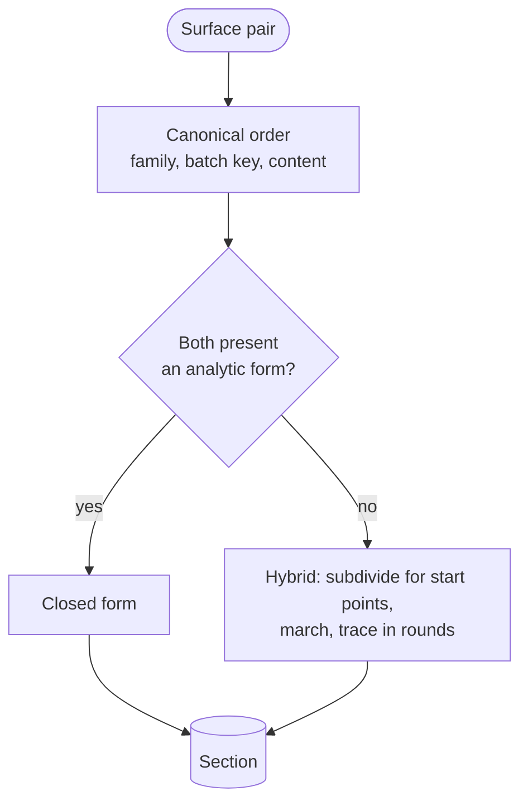

# Intersection

[Architecture](../ARCHITECTURE.md) › Intersection · crate [`occam-intersect`](../../crates/occam-intersect/src/lib.rs) · sketch [`intersect.rs`](../sketch/src/intersect.rs)

Where two surfaces meet, and where an edge crosses a surface. An ordered list of methods; what failed stays beside
what was found.

## Surface against surface

| A `Section` holds | Meaning |
|---|---|
| curves | Each with its image on both surfaces |
| contacts | A point of tangency, or `BelowResolution`: a contact or loop smaller than this tolerance can tell apart (O24) |
| coincidence | Coplanar or coaxial (O25) |
| failures | A stalled trace, a spent budget, an unresolved leaf, an undecided predicate |
| tally | The decisions made, from [maths](maths.md#robust-decisions) |

- **Canonical order** means swapping the arguments cannot change the answer.
- **A closed form's images** are its curve read through each surface's [chart](geometry.md#parameter-curves), the
  closed form of its parameters. A surface without one, such as a plane's B-spline with uneven poles, declines to the
  next method.
- **The hybrid needs no B-spline form,** so offsets and mesh-backed surfaces reach it: it subdivides by `bounds` alone,
  which for a B-spline is the hull of the part's own poles and so goes on shrinking inside a knot span.
- **Many pairs** run one pair a task, one result each, in pair order, and a method's own work, the hybrid's leaves,
  traces and fits, runs through the same `Exec` (`Method::attempt_shared`), with the same bits.
- **Traced points become curves** through [`fit`](../../crates/occam-intersect/src/fit.rs): B-splines through a trace's
  stations, with images through the same stations' parameters, cut where a surface's parameters jump and refined until
  twice every gap between a curve and a surface's point at its image is within the band. The fit is recorded on the
  curve and on each image; one that cannot reach the band is `intersect.fit-outside-band`, and its curve is kept.

### The hybrid

- **Breadth first,** a level at a time, each part halved across its wider side until its box is a leaf across. A part
  is dropped when its box misses the other's by more than the band, or, against an analytic side, when the implicit
  function's size at the box's middle less the box's half diagonal is above the band (P8). Each is a band decision.
- **A leaf** gives at most one start point, where Newton's method from its middle settles inside it. A leaf where the
  surfaces are within the band of each other at its middle and corners is an overlap, such as a rational cylinder on
  its analytic twin: `intersect.incomplete` for `surfaces-coincide`, not curves. A part halved as far as it goes and
  still larger than a leaf is `intersect.incomplete` for `budget-spent`.
- **The tube** about the curves found is twice each chord's sag wide, and the square root of the band about a touch. A
  start inside it is not traced, and a trace whose ends and middle all lie in it is dropped. Rounds take every so many
  start points, so a round's points are far apart.
- **Lattice seeding alone is not offered:** on P5's 625-component surface it returned 256 of 577 curves and said
  nothing. The hybrid finds all 577 (`just hybrid-many-loops`, nightly).

## Edge against surface

An edge is tested only after its conservative box meets the surface. The culled and unculled runs are compared by
digest in the tests.

Evidence

- [P5](../evidence/2026-11-09-p5.md): closed forms 58 of 58 within 1e-12. The hybrid 104 of 110, with 2 silent failures,
  against 13 for marching alone, none of which marching reported: hence failures kept in the result. Lattice-seeded
  marching returned 256 of 577 curves with no warning, so it is not a route to completeness. Rejection bounds carry a
  rounding margin.
- [S4](../evidence/2026-11-09-s4.md): the ordered method list, and canonical pair order.
- [P8](../evidence/2026-11-09-p8.md): the edge box test removed 66 to 86% of scans.
- The hybrid reaching offsets and mesh-backed surfaces: B:13.
- Coincidence is found only where a family presents an analytic form, so a rational cylinder goes to the general
  method (A:15). Coincident surfaces become a `booleans` step, written test-first from S1's 32 reports and S6's c01 to
  c03 ([O25](open-decisions.md#assumed-answers-no-question)).

