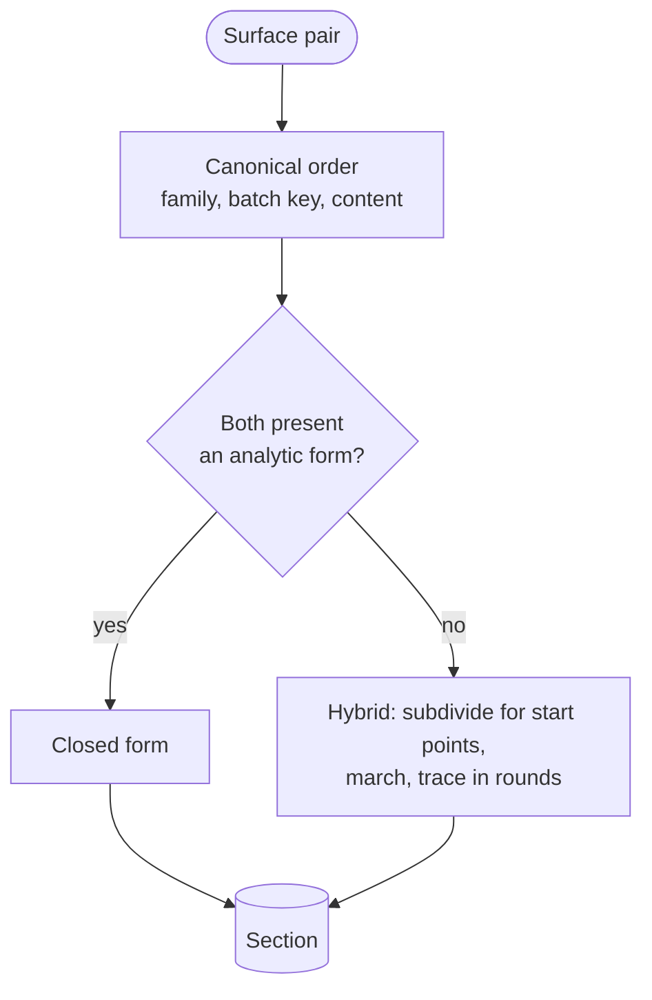

# Intersection

[Architecture](../ARCHITECTURE.md) › Intersection · crate `occam-intersect` · sketch [`intersect.rs`](../sketch/src/intersect.rs)

Where two surfaces meet, and where an edge crosses a surface. An ordered list of methods; what failed stays beside
what was found.

## Surface against surface

| A `Section` holds | Meaning |
|---|---|
| curves | Each with its image on both surfaces |
| contacts | A point of tangency, or `BelowResolution`: a contact or loop smaller than this tolerance can tell apart (O24) |
| coincidence | Coplanar or coaxial (O25) |
| failures | A stalled trace, a spent budget, an unresolved leaf, an undecided predicate |
| tally | The decisions made, from [maths](maths.md#robust-decisions) |

- **Canonical order** means swapping the arguments cannot change the answer.
- **The hybrid works through evaluation and bounds,** not a B-spline form, so offsets and mesh-backed surfaces reach it.
- **Many pairs** run one pair a task, one result each, in pair order.

## Edge against surface

An edge is tested only after its conservative box meets the surface. The culled and unculled runs are compared by
digest in the tests.

Evidence

- [P5](../evidence/2026-11-09-p5.md): closed forms 58 of 58 within 1e-12. The hybrid 104 of 110, with 2 silent failures,
  against 13 for marching alone, none of which marching reported: hence failures kept in the result. Lattice-seeded
  marching returned 256 of 577 curves with no warning, so it is not a route to completeness. Rejection bounds carry a
  rounding margin.
- [S4](../evidence/2026-11-09-s4.md): the ordered method list, and canonical pair order.
- [P8](../evidence/2026-11-09-p8.md): the edge box test removed 66 to 86% of scans.
- The hybrid reaching offsets and mesh-backed surfaces: B:13.
- Coincidence is found only where a family presents an analytic form, so a rational cylinder goes to the general
  method (A:15). Coincident surfaces become a `booleans` step, written test-first from S1's 32 reports and S6's c01 to
  c03 ([O25](open-decisions.md#assumed-answers-no-question)).

