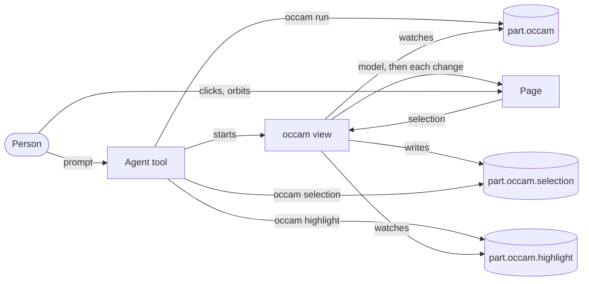

# Live view

[Architecture](../ARCHITECTURE.md) › Live view · crates `occam-cli`, `occam-mesh`, `occam-wasm`; `web/`

A person prompts an agent in the agent tool they already use. The agent builds with [the `occam` command](command-line.md),
and a page shows the model as each run saves it ([decision](../decisions/2026-11-14-prompt-driven-building-shown-live.md)).
The model file is where the two meet: nothing holds the model in memory between commands.

## The commands

| Command | What it does |
|---|---|
| `occam view --model part.occam` | Starts the model's server if none runs, prints the page's address, opens it, and returns |
| `occam view --model part.occam --status`, `--stop` | Says whether the model's server runs and where; stops it |
| `occam selection --model part.occam` | Describes what the person has selected, as `describe` does |
| `occam highlight --model part.occam edge:41/1 ...` | Shows the agent's ids in the page; `--clear` removes them |
| `occam skill --install` | Copies the occam skill into this project's `.claude/skills/` |

## The server

- **The agent starts it** ([decision](../decisions/2026-11-14-the-agent-starts-the-viewer.md)). `occam view` starts
  the server, the same program run again as a process of its own, waits until it listens and has read the model once,
  prints the address (with the token and the model's digest under `--json`), opens the page unless `--no-open`, and
  exits. It opens the page with the program `BROWSER` names, or the system's opener, and only if no page is open.
- **One server per model.** A state file beside the model, `part.occam.view`, names the process, port and token as
  `{"schema", "pid", "port", "token"}`, written whole and readable by its owner alone. A second `occam view` asks that
  server what it watches and prints its address instead of starting another; a state file whose server does not answer
  is stale, and is replaced. A server whose state file comes to name another server stops.
- **It runs until stopped:** by `occam view --stop`, or by itself when no page has been open for an hour.
  `--status` says whether it runs and where, with how many pages are open and why the model does not read.
- **axum on tokio,** in `occam-cli` only ([decision](../decisions/2026-11-14-axum-and-tokio-for-the-viewer.md)), on one
  thread. A model is opened on a blocking thread, never on the async one.
- **The page is in the binary.** `just web-build` builds it into `crates/occam-cli/page/`, which the next build of
  `occam` embeds; a plain `cargo build` embeds a stub page that names the recipe, so `occam view` needs nothing beside
  it either way. The page it serves has its `<html>` marked `data-live`.
- **This machine only.** It listens on `127.0.0.1`, on a free port unless `--port` names one (`view.port-taken` if it
  is taken), and every address begins with the token: `http://127.0.0.1:<port>/<token>/`. Anything else is refused, so
  another page on the machine cannot read the model or post a selection.
- **Change by polling.** It looks at the model file's size and modification time five times a second. When they
  change and the file reads whole, it sends the page an event naming the model's digest. A file that does not read
  may be half-written, so it is read again at the next look, and named only once a look finds it unchanged: the
  kernel's reports for a file that is not a model, and `view.model-missing` for one that is not there, in the page and
  on the command line, while the server keeps watching and the page keeps drawing the last model that read.
- **Routes,** each under the token: the page and its files; `model`, the last model that read whole as [the binary
  twin](files.md), whichever form the file is in, naming its digest in `x-occam-digest`; `events`, a stream of
  server-sent events, `model` when another model reads whole and `refused` when the file does not, each carrying what
  the server says of the model (its digest, its reports and the pages open); `status`, the same, for the command line;
  and a post to `stop`. Highlight and selection events, and a post of the selection, come with `view.select`.

## The page

- **What [`view`](../plan/view.md) builds.** The [editing worker](browser.md) loads the twin, the mesh workers mesh it,
  and [WebGPU](mesh-and-renderer.md) draws it. An event makes it fetch the model again. The editing worker opens it and
  says which faces changed since the model drawn (`occam_mesh::again`, from the two models alone: the faces drawn from
  anything written since, and those along an edge whose samples changed), and only those are meshed again; every other
  face keeps its block and what was reported of it. One model is fetched and meshed at a time.
- **View controls** move the camera over the same mesh: orbit, pan, zoom, centre on the selection, fit the model to the
  window.
- **Selection.** A click picks against the CPU mesh (an edge wins over its faces within a few pixels) and selects what
  it hit; shift-click adds or removes. The page posts the ids with the digest of the model it shows.
- **Highlight** draws the agent's ids in a second colour, apart from the selection.

## The selection file

- **JSON beside the model:** the model's digest and a list of ids, in the order they were selected. Each writer writes a
  temporary file and renames it over the old one, so a reader never sees half a file.
- **`occam selection`** describes each id against the model. If the file's digest is not the model's, the selection is
  stale: it says so, with the remedy of selecting again, and describes nothing.
- **Carried over by `occam run`.** After a run commits, it maps each selected id through the run's
  [changes](operations.md): an entity changed keeps its id, one replaced becomes those that replaced it, one deleted
  drops out. It writes the file again with the new digest, and its result says what became of each id. It does this
  only if the file's digest was the model's before the run, so a stale selection is never made to look fresh.
- **A post for an older model is refused,** so the page fetches the new model and the person selects again.
- **The highlight file** has the same form. `occam run` clears it, since it named what the agent was about to change.

## What waits

- **An in-memory session server** that the commands talk to, which a web service with the prompt in the browser would
  grow from, and **the in-page chat**: after the first release
  ([decision](../decisions/2026-11-14-prompt-driven-building-shown-live.md)).
- **Editing in the page,** write-through included: with the editing tools
  ([decision](../decisions/2026-11-14-write-through-after-the-first-release.md)).
