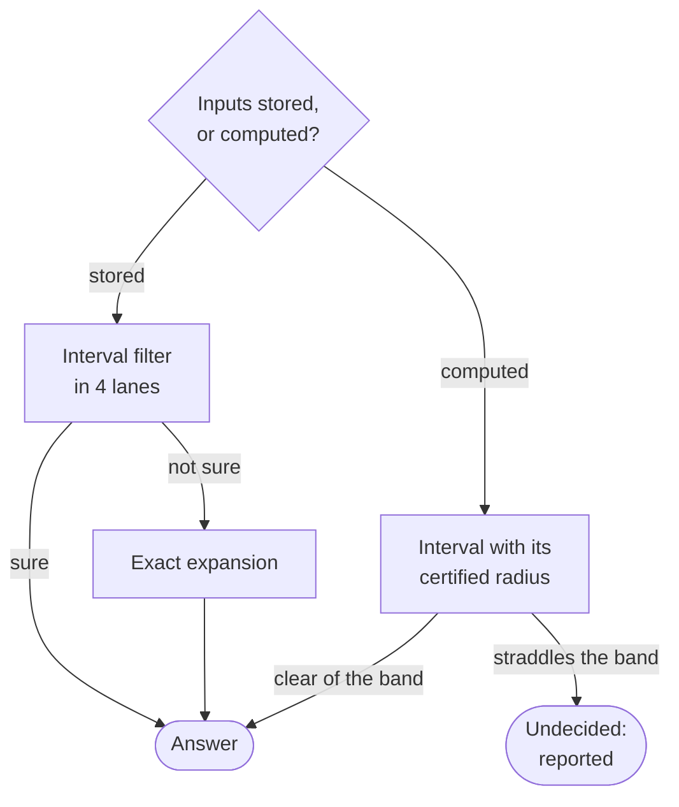

# Maths

[Architecture](../ARCHITECTURE.md) › Maths · crate `occam-math` · sketch [`math.rs`](../sketch/src/math.rs)

All computing goes through one crate: numbers that run as `f64` or in lanes, owned trigonometry, and decisions that
are either exact or say they cannot decide.

## Robust decisions

- **`decide_stored`** works on stored numbers. It is undecided only for an input that is not finite, or too large or
  too small for the exact stage to be exact at the predicate's degree (found in `maths`).
- **`decide_computed`** works on computed values. It answers `Undecided`, "cannot decide at this resolution" (O11),
  which becomes [a report](reports.md#cannot-decide-at-this-resolution).
- **`Interval`** is a midpoint and radius rounded outward with `+ - * /` and `sqrt` only: no rounding modes.
- **`Predicate<N>`** is written once over `Ring`, so the same formula runs as interval, exact or plain.
- **No exact towers by default:** their work grows about 5× a step.
- **`Tally`** counts decisions, exact fallbacks and undecided ones. Every operation reports it.

## Numbers and lanes

| Piece | What it does |
|---|---|
| `Real` | One number type for `f64` and lanes. Gains `lt`, `le`, `select` and a mask. `f64::min` stays banned |
| Owned `sin_cos`, `atan2` | The same bits on every target, lane width and build (O14). `tan`, `atan`, `asin`, `acos` follow when needed |
| `Level::detect()` | Finds the widest instruction level, once |
| `dispatch(level, kernel)` | Runs a `LaneKernel` compiled for that level, inside a family's batch method |
| `Lanes::from_fn` | Becomes a plain loop |

Every level gives the same bits, because nothing fuses, so [`DETERMINISM.md`](../DETERMINISM.md) rule 5 stands. The
execution layer, `Exec`, is in this crate too: see [threads and lanes](threads-and-lanes.md).

Evidence

- [S2](../evidence/2026-11-09-s2.md): the interval filter, the exact stage, `Undecided`, and exact towers growing about
  five times a step.
- [P6](../evidence/2026-11-09-p6.md): each 1% of decisions reaching the exact stage adds about 33 ns a decision on one
  thread, hence `Tally` in every outcome.
- [S5](../evidence/2026-11-09-s5.md): the owned functions, within about 0.75 and 1.5 ulps. Their coefficients are
  [occam's own fit](../decisions/2026-11-11-own-coefficients.md) (O15).
- [P4](../evidence/2026-11-09-p4.md): a kernel is a trait, not a closure, because `run` and all it calls must be
  `#[inline(always)]` or a leaf compiles without the level's features, and a closure cannot carry that attribute on
  stable Rust (B:8). Dispatch cannot cross `dyn` (A:10). `array::from_fn` falling out of line cost a rational kernel
  2.3×.
- [S4](../evidence/2026-11-09-s4.md) and [P5](../evidence/2026-11-09-p5.md) had to build comparison and selection
  through `to_array`.

