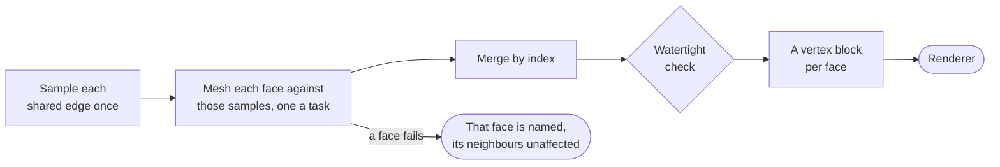

# Mesh and renderer

[Architecture](../ARCHITECTURE.md) › Mesh and renderer · crate `occam-mesh` · sketch [`mesh.rs`](../sketch/src/mesh.rs)

Triangles for display: shared edges first, so neighbouring faces meet exactly, then faces, then a check.

- **Limits first:** a floor on the step a surface may ask of a shared edge; caps on samples per edge and triangles per
  face.
- **Point location uses the exact predicates** on real coordinates.
- **Chordal error is measured** to the triangle.
- **The watertight check runs on every output,** in production too.
- **Each face's mesh is its own vertex block,** with a normal per vertex from the surface. Along a shared edge its
  positions are that edge's samples, so neighbours hold the same bits there: no cracks, no welding.

## The renderer contract

- Buffers readable by both a storage binding and a vertex fetch.
- Index buffers that stay stable while the topology does.
- Per-face ranges and dirty rectangles.
- Uploads bounded per frame.
- Camera-relative coordinates from the first version: an `f64` origin with `f32` offsets.
- A frame loop that keeps submitting during interaction.

**GPU results are display-only:** never in digests, caches, meshes, picking, measurement, export or the watertight
check ([the GPU drawing decision](../decisions/2026-11-09-gpu-drawing.md)).

Evidence

- [P9](../evidence/2026-11-09-p9.md): this method gave 4.7 to 5.2× at six threads, with the same bits at every thread
  count and lane width. Without limits, one collapsed NURBS row took 11.9 GB in seconds. P9's integer grid for point
  location caused all three of its failures. "Watertight by construction" covers only the faces that meshed.
- [P12](../evidence/2026-11-09-p12.md): the renderer contract, and GPU output kept out of the kernel.
- Per-face blocks giving P12's layout without welding: B:13.

