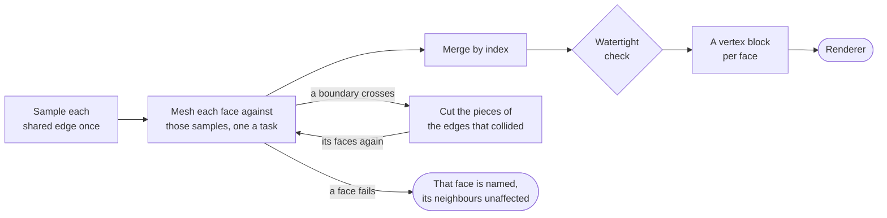
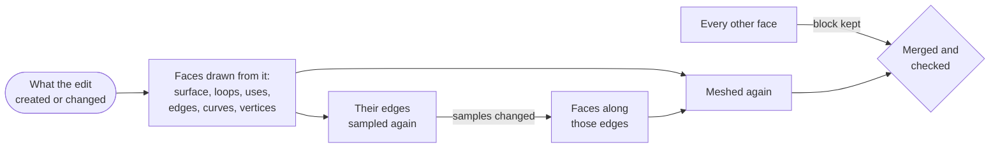
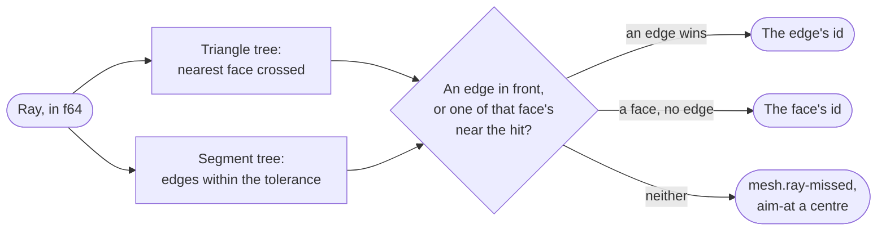

# Mesh and renderer

[Architecture](../ARCHITECTURE.md) › Mesh and renderer · crate [`occam-mesh`](../../crates/occam-mesh/src/lib.rs) · page `web/`

Triangles for display: shared edges first, so neighbouring faces meet exactly, then faces, then a check.

- **Limits first:** a floor on the step a surface may ask of a shared edge; caps on samples per edge and triangles per
  face.
- **Point location uses the exact predicates** on real coordinates.
- **Chordal error is measured** to the triangle, through cross products where a triangle is a sliver, as the region
  test's dot products lose a thin triangle's area to rounding.
- **Repair cuts only the edges that collided** ([`repair`](../../crates/occam-mesh/src/repair.rs)), as P9's repair, which
  cut every edge of a face that failed, took a model from 1 s to 144 s. Where a face's boundary, drawn through its
  edges' samples, crosses or touches itself, the two pieces that collided are cut at their middles and the boundary
  tried again, at most 64 times and never past an edge's cap. Finer samples cannot part two points at one place, so
  repair is not tried there. A face it does not cure keeps no cut and is named with the edges that collided.
  A face's cuts depend only on it and its edges' first samples, so each edge takes the cuts of every face along it,
  and the whole mesh, a part of it and a mesh made again after an edit cut it alike.
- **The watertight check runs on every output,** in production too. It matches vertices by position, not by index, as a
  pole or an apex holds two at one place: every segment is used once each way, or once along a sheet's rim, and each
  shell's mesh has its faces' Euler characteristic. A face that did not mesh is a named hole.
- **Each face's mesh is its own vertex block,** with a normal per vertex from the surface. Along a shared edge its
  positions are that edge's samples, so neighbours hold the same bits there: no cracks, no welding.

## The renderer contract

- Buffers readable by both a storage binding and a vertex fetch.
- Index buffers that stay stable while the topology does.
- Each index counts from the start of its face's vertex block, so a block is kept, moved or dropped without rewriting
  the others.
- Per-face ranges and dirty rectangles.
- Uploads bounded per frame.
- Camera-relative coordinates from the first version: an `f64` origin with `f32` offsets.
- A frame loop that keeps submitting during interaction.

## The buffers

[`Buffers`](../../crates/occam-mesh/src/buffers.rs) are a mesh as the contract wants it. `occam mesh` writes them,
and `occam-wasm` gives them as typed arrays.

- **Flat arrays:** `f64` positions and unit normals, three each; each vertex's `(u, v)` on its face, two, kept for
  write-through; and `u32` indices, three a triangle.
- **Per face, in id order:** its vertex block and its range of triangles. A refused face has neither, and its report
  says why.
- **After an edit,** [`remesh`](../../crates/occam-mesh/src/remesh.rs) meshes only what the edit touched, read from
  what its `Changes` say it created or changed, and the faces along an edge repair cut. Every other face keeps its
  block bit for bit, and the result is the mesh the model gives meshed whole. A mesh that repair cut does not say which
  face cut each edge, so a model meshed with one is meshed whole again.
- **In parts,** as the [mesh workers](browser.md) mesh a model, [`mesh_part`](../../crates/occam-mesh/src/part.rs)
  meshes some faces alone. Each edge they use takes the step every face along it asks, and the cuts repair makes in
  every face along it, those outside the part checked too, so their blocks are the whole mesh's bit for bit. A part is
  checked watertight as far as it reaches: along an edge to a face outside it, a segment may be used once.

**The file `occam mesh` writes,** beside the model as `part.occam.mesh` or to `--out`, is the buffers as they are,
little-endian, with nothing else:

| Numbers | What |
|---|---|
| 3 `u64` | how many vertices V, triangles T and faces F |
| 3V, 3V and 2V `f64` | every position, then every normal, then every `(u, v)` |
| 3T `u32` | the indices |
| 6F `u32` | each face: its slot and generation, its first vertex and how many, its first triangle and how many |

The `f64` arrays start on a multiple of eight bytes, so each can be read in place.

**GPU results are display-only:** never in digests, caches, meshes, picking, measurement, export or the watertight
check ([the GPU drawing decision](../decisions/2026-11-09-gpu-drawing.md)).

**"Show mesh",** a toggle in the page, off by default, draws each face's triangle edges over its shading, each once
within its face, as pairs of indices into the vertex buffer its triangles are drawn from; an edit gives new lines only
to the faces it meshes again ([decision](../decisions/2026-11-16-the-page-can-show-its-mesh.md)).

**During a continuous edit**, once the editing tools arrive after the first release, the GPU writes the touched faces'
blocks at each vertex's `(u, v)` on its face, until the CPU mesh replaces them
([decision](../decisions/2026-11-14-write-through-after-the-first-release.md)).

## Picking

A pick tests a ray against the CPU mesh and answers with the model's own id
([decision](../decisions/2026-11-13-picking-in-the-first-release.md)). A
[`Picker`](../../crates/occam-mesh/src/pick.rs) is built with a mesh: a box tree over every face's triangles, and one
over every edge's samples as segments, both built on one thread, ties broken by number, so the same ray gives the same
answer at any thread count and on every target.

- **A face is hit** where the line through the ray's start and the point a millimetre along it crosses one of its
  triangles, decided exactly by the sign of the volume each side makes with that line, so a ray through a side two
  triangles share hits both, never neither. The nearest face hit wins, then the smaller id.
- **An edge is hit** where its samples come within the tolerance of the ray, at or after its start. It wins over the
  nearest face if it lies no further along the ray than that face plus the tolerance, or if it is one of that face's
  own edges within the tolerance of where the ray crosses it; so the seam at the back of a cylinder does not win over
  its front. Of the edges that win, the one nearest the ray wins, then the one nearest along it, then the smaller id.
- **A ray that hits nothing** is `mesh.ray-missed`, whose `aim-at` remedy is the centre of the triangle that lies
  nearest the ray's way, seen from its start, of those that the ray from the start towards their centre crosses, built
  as `occam pick --towards` builds it: following the remedy is sure to hit.

Evidence

- [P9](../evidence/2026-11-09-p9.md): this method gave 4.7 to 5.2× at six threads, with the same bits at every thread
  count and lane width. Without limits, one collapsed NURBS row took 11.9 GB in seconds. P9's integer grid for point
  location caused all three of its failures. "Watertight by construction" covers only the faces that meshed.
- [P12](../evidence/2026-11-09-p12.md): the renderer contract, and GPU output kept out of the kernel.
- Per-face blocks giving P12's layout without welding: B:13.
- P9's adversarial catalogue rebuilt as models
  ([`adversarial.rs`](../../crates/occam-ops/src/adversarial.rs)): every case meshes watertight within its deflection,
  the grid's three failures included; its holes under a chord once repair cuts the arc and the hole.

