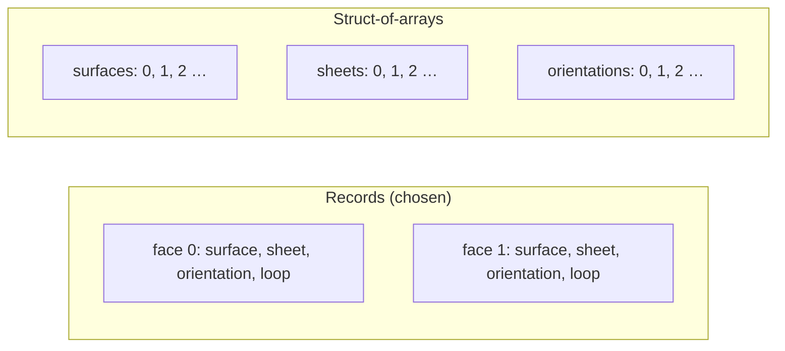
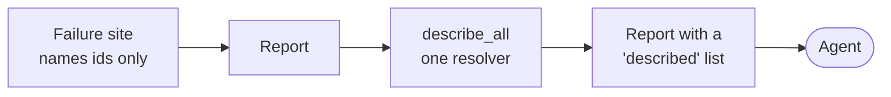

# Decisions

[Architecture](../ARCHITECTURE.md) › Decisions

Four questions, each with a recommendation, and [the assumed answers](#assumed-answers-no-question). The user approved
every one with the architecture ([decision](../decisions/2026-11-11-the-architecture-and-its-answers.md)). This page
keeps the reasoning.

| | Question | Answer |
|---|---|---|
| [O12](#o12-the-default-tolerance) | Default tolerance for a new model | 1e-7 mm and 1e-9 rad |
| [O22](#o22-how-topology-is-laid-out-in-memory) | Topology in memory | Records, not struct-of-arrays |
| [O23](#o23-the-wording-of-l29) | Lesson L29's wording | Narrow its first sentence |
| [O26](#o26-how-an-agent-learns-what-an-entity-is) | How an agent learns what an entity is | Ids, described by one resolver |

## O12: the default tolerance

For a new model whose request gives none. The outcome says which was used.

| Default | Verdict |
|---|---|
| **1e-7 mm** (chosen) | Every spike measured here |
| 1e-6 mm | No gain: S1's three "open" results at 1e-7 were quadrature noise. Near-tangent vertices move 3× further |
| 1e-9 mm | Too fine: S2's intervals fail inside the band in 11.1% of cases, against 0.2% |

1e-9 rad is 1e-7 mm on a 100 mm lever. Choosing otherwise changes only the default and the test fixtures.

## O22: how topology is laid out in memory

At a million faces (S3-P3):

| | Records | Struct-of-arrays |
|---|---|---|
| Take a snapshot | **183 µs** | 1,191 µs |
| Scattered edit | **14 µs** | 23 µs |
| Edit in place (chunks of 4,096) | **1.37 µs** | 1.98 µs |
| Bounds, scrambled order | **297 ns** | 379 ns |
| Read scaling at 6 threads, memory-bound microbenchmark | 3.23× | **4.83×** |
| Read scaling at 6 threads, real per-face work | 5.4 to 5.6× | 5.4 to 5.6× |

Records win what booleans and edits do. This **reverses** the plan's earlier recommendation. Callers read through
views, so switching later changes [one module](topology.md#storage), and the `topology` milestone re-measures.

## O23: the wording of L29

[L29](../evidence/2026-11-08-phasekit-lessons.md)'s first sentence did not hold as written; its second did (P5).

| | Before | Now |
|---|---|---|
| 1st | Batch surfaces by kind and degree. | Sort calls by family and degree. Evaluate one surface at many points in a batch. Use lanes per kernel class only where the vectorisation gate measures a gain. Group stored surfaces by family when memory asks. |
| 2nd | Keep intersection marching scalar, but parallel across curves. | Unchanged |

Sorting calls gains 14 to 18% (S4), one surface at many points 1.8 to 3.3× (P9). Grouping *storage* by kind gained no
measured speed, only 15% memory ([geometry](geometry.md#no-cross-family-store)).

## O26: how an agent learns what an entity is

A failure names an entity, say an edge. The agent needs to know what that edge is.

| Option | Problem |
|---|---|
| **One resolver fills in descriptions inside the report** (chosen) | |
| Ids only; descriptions in a separate envelope (proposal A) | Two documents to read, a shape S6 never tested |
| Each failure site writes its own (proposal B) | A site can forget; phase outputs would carry model ids |

With descriptions inside, S6's blind agents handled 6 of 6 cases, against 4 of 6. More in
[reports](reports.md#how-an-agent-learns-what-an-entity-is).

## Also recorded, not asked

- **O21 is recorded as answered** by [PARITY](../PARITY.md) rows 2.1 and 2.2, which you approved: "evaluation to any
  derivative". The plan had recommended two orders.
- **Fillets were never prototyped.** No extra spike recommended; `blends` starts with the feasible radius
  ([risks](risks.md)).

## Assumed answers (no question)

| | Assumed | The cost of the other answer |
|---|---|---|
| O11 | "Cannot decide" is a reported outcome | Always picking a side: wrong in 25 to 44% of S2's steps, or 5× the work |
| O14 | Own `sin_cos` and `atan2` | Analytic families 1.5 to 2.7× slower; bits differ by target |
| O16 | Same bits in browser and server: promised later, for owned functions | Promised now: every new transcendental owned first |
| O18 | Nothing required of the hosting page | Nightly Rust and a new dependency |
| O21 | Derivatives to any order | An offset's second derivative off by about 1e-5 |
| O24 | A loop below resolution is reported | P5's silent wrong shapes stay silent |
| O25 | Coincident surfaces: a `booleans` step, no spike | That step waits for a spike |

Each answer is worded in [the decision](../decisions/2026-11-11-the-architecture-and-its-answers.md). The figures
behind these come from [S2](../evidence/2026-11-09-s2.md) (O11), [S5](../evidence/2026-11-09-s5.md) (O14, O16),
[P10](../evidence/2026-11-09-p10.md) (O18), [P5](../evidence/2026-11-09-p5.md) (O24) and
[S1](../evidence/2026-11-09-s1.md) (O25).
