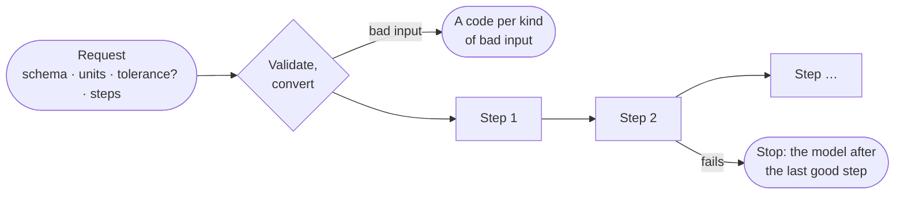
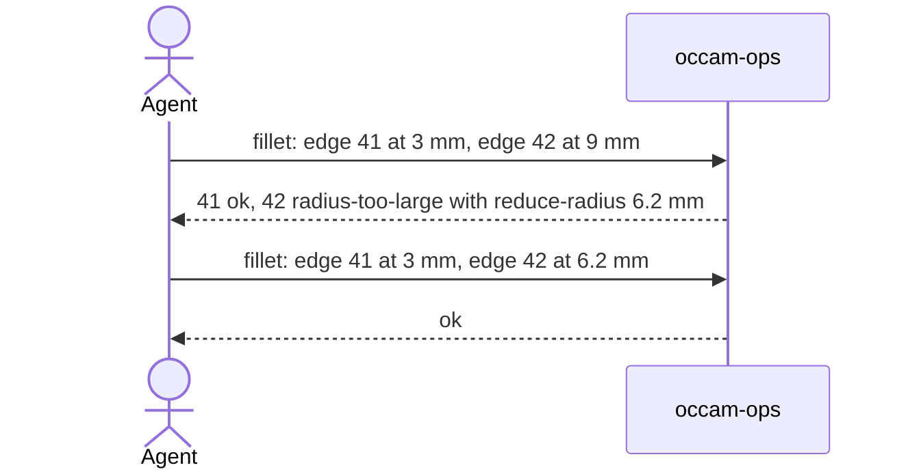

# Operations

[Architecture](../ARCHITECTURE.md) › Operations · crate `occam-ops` · sketch [`ops.rs`](../sketch/src/ops.rs)

Operations are data. A request is checked and converted once, before any geometry, then its steps run in order.

## A request

- **Each step** has an optional label that later steps can use as an operand, or names an entity by id.
- **Bad input** gets a code naming the operation, parameter, value and rule.
- **Nothing that failed changes the input.** Steps stop at the first failure.
- **The tolerance belongs to the model.** A new model takes the request's, or [O12's default](open-decisions.md#o12-the-default-tolerance),
  and the outcome says which. On an existing model the model's governs.

## The operations

The first release's [PARITY](../PARITY.md) rows: box, cylinder, sphere, cone, torus, wedge; wires through points,
lines and arcs; planar faces with holes; extrude; revolve; transform, with a copy; fuse, cut and common
([the boolean](boolean.md)); fillet and chamfer; measure. Everything else is refused, by name.

## One result per item

A step with many items, such as a fillet on many edges, returns one result per item. Its `commit` field chooses:

| `commit` | Applies |
|---|---|
| `all-or-nothing` | Nothing unless every item succeeds. Items that would have succeeded say so |
| `feasible` | The items that succeed |

## Fillets

An example, with made-up numbers:

- **A radius per edge,** so following a remedy changes one number.
- **The radius offered is the largest the kernel certifies,** a band inside the true limit, so following it never
  lands on an undecided case.
- If the checker refuses the result, lineage names the item whose entities it rejected.

## Measure

Volume, area and centre of mass by the divergence theorem over the faces, with adaptive quadrature. The bracket test's
oracle compares the volume.

Evidence

- [S6](../evidence/2026-11-09-s6.md): blind on S1's report, an agent "repaired" a zero-radius hole by setting
  0.0001 mm, hence a code per kind of bad input.
- The tolerance owned by the model: B:7. `measure.tolerance-used` and `measure.tolerance-below-model` exist today.
- A radius per edge, and the certified radius: A:3, B:2. Mass properties for the oracle: A:3, PARITY 1.8.
- One result per item is L6; nothing failed changes the input is L5.

