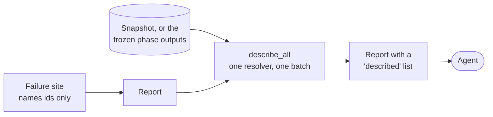

# Reports

[Architecture](../ARCHITECTURE.md) › Reports · crate `occam-report` · sketch [`report.rs`](../sketch/src/report.rs)

Every result carries reports an agent can act on: a code, a fault class, values, remedies, and the entities involved,
described. The schema becomes version 2.

## How an agent learns what an entity is

- **A failure site names ids and nothing more.** No site can forget to describe.
- **As the result leaves the kernel,** the `occam` crate's `describe_all` describes every id in it, in one batch.
- **Each description** gives form, parameters, extent and position in the caller's units, origin, and neighbours.
- **`occam describe`** asks the same resolver later, for many ids at once.

This is the recommendation for [O26](open-decisions.md#o26-how-an-agent-learns-what-an-entity-is).

## What changes in schema 2

| Field | Change | Why (S6) |
|---|---|---|
| Entity reference | Kind, slot and generation, one text form: `edge:41/1`. New kinds: edge use, loop, wire, body, bare geometry, and section and region for failed operations | Four agents of ten could not read a packed id |
| Fault class | Invalid input, not implemented, numerically sensitive or internal, chosen where the failure is found | An agent could not tell a repairable input from an unsupported one |
| Reason | A closed list, not free text | Agents read a message's length as a ratio |
| Stage | Validate, prepare, broad, … | Says where it failed |
| `Partial` | Gains its stage, loses `last_valid` | No agent used it; the input is unchanged anyway |
| Named value | Can hold a point; NaN and infinities still round-trip | A position is one value |
| Tolerance in force | Added whenever a tolerance decided the outcome | An agent reasoned from the wrong one |
| Empty result | A `boolean.empty-result` note with the operands' separation | An agent got `ok` and a volume of 0 |

Every new code and remedy has a test that follows the remedy (L2).

## Cannot decide at this resolution

When [maths](maths.md#robust-decisions) answers `Undecided` (O11), the operation reports `decide.undecided`, fault
`numerically-sensitive`, with the quantity, its certified radius, the band and the near-tangent shift. Remedies:
`move-apart` and `use-tolerance`.

Evidence

- [S6](../evidence/2026-11-09-s6.md): every row of the table above. With descriptions inside the report, the enriched
  blind run handled 6 of 6, against 4 of 6. A long list of reports can distract, so order matters. c07 could not tell
  a repairable input from an unsupported one, and blind c12 showed a default fault per code misleads; c04 reasoned
  from the wrong tolerance; c05 got `ok` and a volume of 0.
- [S4](../evidence/2026-11-09-s4.md): geometry with no topology needs a kind of its own.
- One text form for ids: A:13. Points through today's `number` module: B:11. Proposals A (ids only) and B (each site
  describes): [open decisions](open-decisions.md#o26-how-an-agent-learns-what-an-entity-is).

