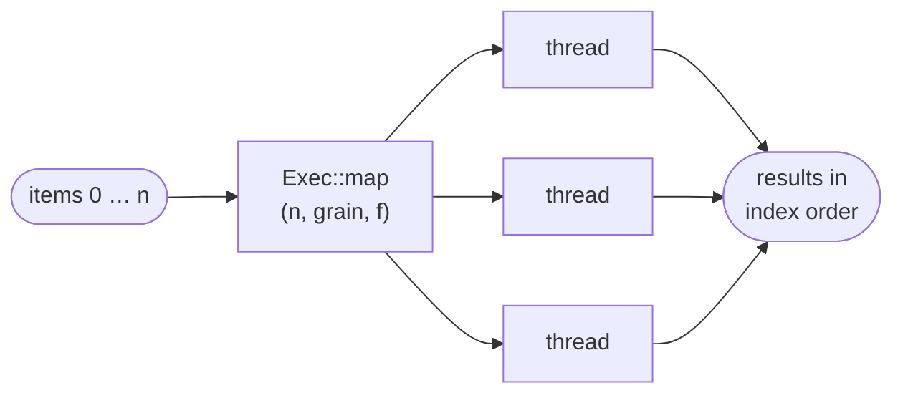

# Threads and lanes

[Architecture](../ARCHITECTURE.md) › Threads and lanes · crate [`occam-math`](../../crates/occam-math/src/lib.rs)

Threads go across items; lanes go inside each task. They multiply: four lanes (1.48×) and six threads (5.5×) gave 8.2×
one scalar thread (P6).

## `Exec`: the one way to run in parallel

- **Results come back in index order,** whatever order they finished in. There are no reductions, so nothing depends on
  how the work was split.
- **Two runners:** `rayon` natively, and `Serial`, the one-thread baseline that also runs inside each browser worker.
  `Exec` is a concrete type, so no kernel is generic over its runner.
- **`Grain::Each`** puts one item in a task, for items of 10 µs or more: a face, a pair, a region.
  **`Grain::Auto`** leaves cheap items to the runner.
- **`map_chunks`** runs a batch in fixed chunks. A chunk is both the task and the lane group. Chunk boundaries depend on
  the chunk size, never on the thread count.

## Who runs how

| Work | Threads | Lanes |
|---|---|---|
| Broad phase, edge box tests | `Auto` | masks at 8 |
| Prepare, face split, checker | one face a task | one surface at many points |
| Sections | one pair a task, traces in rounds | none: marching is scalar |
| Edge split | three rounds, sequential merges | none |
| Classify | one region a task | crossing number at 8 |
| Stitch and commit | sequential | none |
| Robust decisions | `map_chunks`, 256 to 1,024 items | interval filter at 4 |
| Tessellation | edges, then faces; in the browser about 64 calls a job | one surface at many points |

**Lane width is set per kernel class,** inside the family that runs it: masks 8 (4 on wasm), predicate filters 4,
analytic `sin_cos` and `atan2` 4, splines 4 to 8 (2 where spans change), rational derivatives 1, marching scalar. The
measured ones live in [`occam_math::width`](../../crates/occam-math/src/width.rs). Every lane kernel must pass a
`gates perf` check that it vectorised and beats width 1 on each target, or it runs at width 1: natively at most 90% of
width 1's instructions, and in the browser's simd128 build at least 1.15 times as fast.

**Two limits.** Beyond the last-level cache, cheap kernels gain nothing from threads; the remedy is fewer bytes per
point. A finer grain inside one large face waits for a real profile.

Evidence

- [P11](../evidence/2026-11-09-p11.md): `rayon`'s float `sum` gave 7 bit patterns in 8 runs, hence no reductions.
  Items of 100 ns reached 5.65× at six threads on `Auto`, against 3.94× with one item a task (B:8). Closures are
  `'static`, which keeps a swap to a small pool possible.
- [P6](../evidence/2026-11-09-p6.md): chunks as both task and lane group; 8.2× from lanes times threads.
- [P4](../evidence/2026-11-09-p4.md): masks at 8 gave 5.8 to 5.9× with AVX2 from a baseline build. Kernels can compile
  cleanly and still run scalar, hence the gate. Cheap kernels beyond the cache: 1.02× at six threads. P4's analytic
  kernel with precomputed trigonometry lost 2 to 3× at width 2.
- [P9](../evidence/2026-11-09-p9.md): an analytic kernel with sine and cosine in lanes went from 30.0 to 18.4 ns, so
  analytic widths are unsettled. Splines were 1.5× faster reorganised around the grid, before any lanes.
- [P1](../evidence/2026-11-09-p1.md), [P2](../evidence/2026-11-09-p2.md), [P5](../evidence/2026-11-09-p5.md) and
  [P10](../evidence/2026-11-09-p10.md): the grains in the table.

