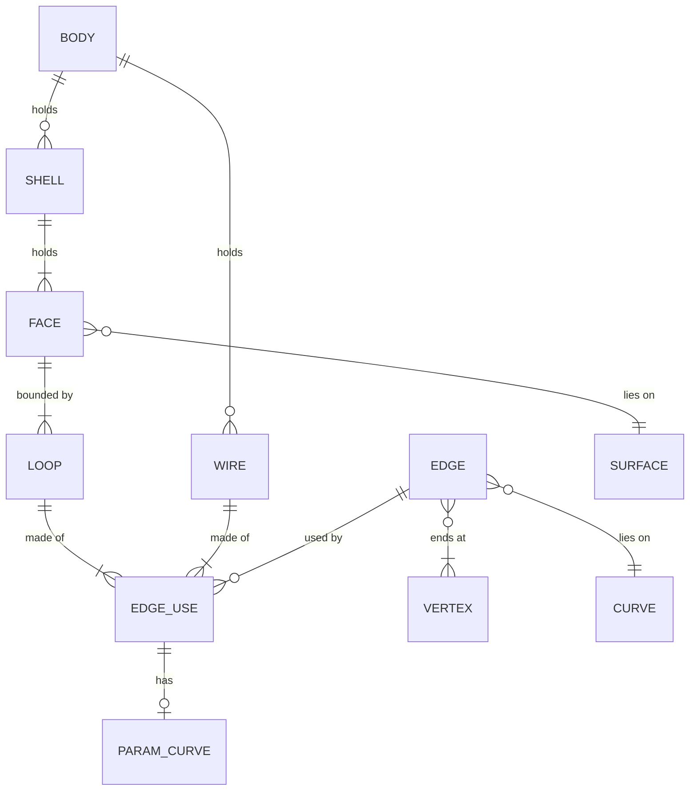
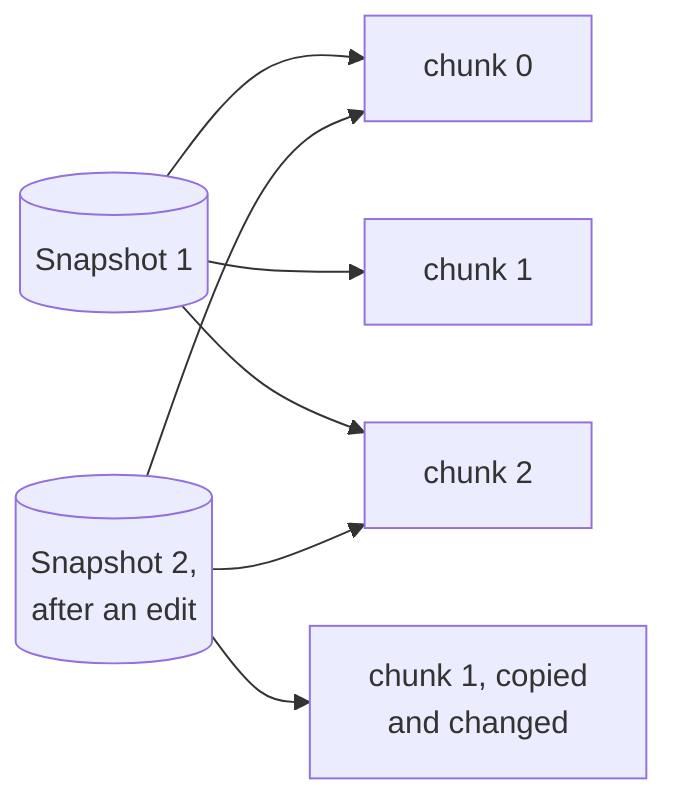
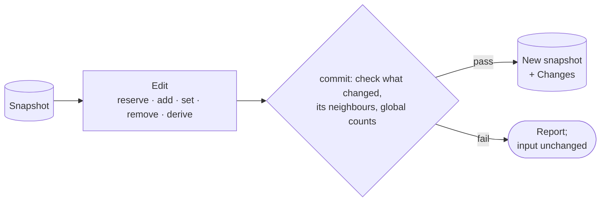
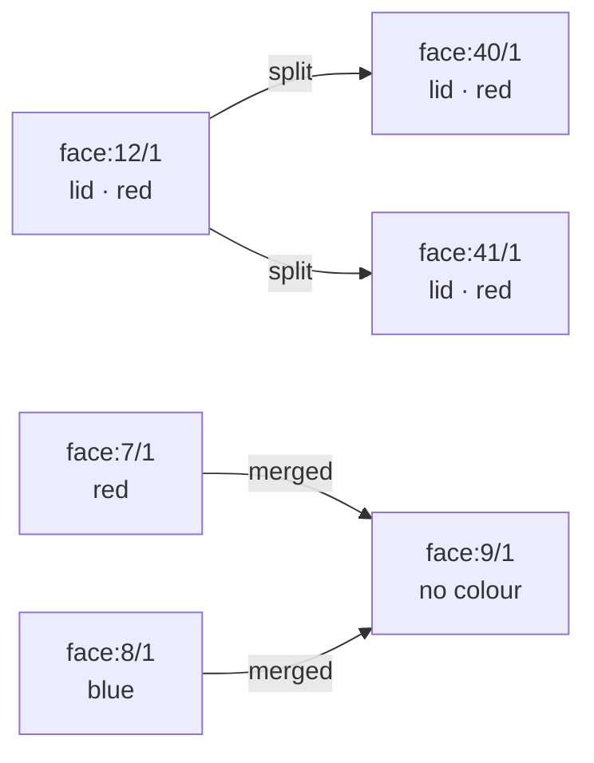

# Topology

[Architecture](../ARCHITECTURE.md) › Topology · crate `occam-topo` · sketch [`topo.rs`](../sketch/src/topo.rs)

The B-rep: what the entities hold, how they are named, how they are stored, and the one way to change them.

## Entities

| Entity | Holds, beyond the links |
|---|---|
| Body | Kind: solid, sheet or wire |
| Face | Orientation; the sheet of each periodic parameter its loops lie in |
| Loop | An interior point, as witness for which loop is outer |
| Edge use | Direction; the next use around; the next use of the same edge, so an edge can have any number of uses |
| Edge | Range; role (ordinary, seam, section); measured deviation from each face |
| Vertex | Position; certified radius; one edge of its star. Merged by the band; a pinch is a vertex with many edges |

- **Seams are real edges** between chart-sized patches. No face crosses its own seam.
- **Provenance:** bodies, faces and edges record the step that made them and their part in it (profile, target, tool,
  input, made). Step numbers count over the model's life. This is what agents asked for first (S6).

## Ids

An id is a **slot and a generation**, with its kind as a type, written `edge:41/1`.

- The generation changes only when a slot is reused. An entity changed in place keeps its id.
- A stale id is a `topo.stale-id` report, never the wrong entity.
- Free slots are reused lowest first, so ids depend only on the table, and survive a save and a load.

## Storage

- Records sit in **copy-on-write chunks of 1,024** per kind. A snapshot is immutable; cloning it shares every chunk.
- Callers read through **per-kind views** (`FaceView`, `EdgeView`, `VertexView`), field by field. So the layout,
  records or struct-of-arrays ([O22](open-decisions.md#o22-how-topology-is-laid-out-in-memory)), belongs to this
  module alone.

## The edit

- `Edit` is the only place ids are given, and `commit` is the only way to make a snapshot. So no unchecked model
  exists.
- `reserve` gives an id for a record written later, so cycles (an edge and its uses) can be built.
- `derive(new, old, how)` records lineage: split, trimmed, merged or copied.
- `Changes` lists what was created, changed and deleted, and each new entity's lineage.
- `Snapshot::check_all` checks the whole model, for loading, importing and tests.

## Names and colours

- **A side table keyed by id,** beside the records and never in them, so no geometric code reads it. Any entity may
  have a name, a colour, both or neither. STEP import fills it (PARITY 2.9).
- **`commit` carries them along lineage.** A split, trimmed or copied entity takes its source's; a merge keeps only
  what every source shares. What the edit sets itself wins. Removing an entity removes them.
- **Stored like the records,** in copy-on-write chunks, so a snapshot costs the same. Saved in the native file and
  covered by the digest.
- **Groups and tags** in the later [document layer](../PLAN.md#6-milestones) can extend this table instead of adding
  a second mechanism.

Evidence

- [S1](../evidence/2026-11-09-s1.md): the entity list, each item backed by a case. Item 1 vertices shared by identity;
  item 2 the face's sheet (the most damaging removal); item 3 the loop witness; item 5 seams; item 6 pinches, which only
  the shell count notices; item 7 parameter curves (without them, the same answers 3.45× slower); item 9 measured
  deviation, in 45% of near-external crossings.
- [S3-P3](../evidence/2026-11-09-s3-p3.md): at a million faces a snapshot takes 183 µs, against 31 ms for a plain arena.
  Chunks of 1,024 suit scattered edits: 14 µs an edit, against 41 µs with chunks of 4,096. Ids as slot and generation.
- [P1](../evidence/2026-11-09-p1.md): checking only what changed keeps the check's cost following the edit; on a plate
  with 64 holes one more hole cost 38× as much otherwise (B:5, A:12).
- The vertex's star link lets a fillet walk it without indexing the model (B:3). Whole-record reads would have made
  struct-of-arrays worse than records (B:3). Body kinds and edge-use counts: PARITY 1.1, 1.6, 1.10, 2.12 (B:1, A:7).
  Step numbers unique across requests (B:4). Ids surviving a load (B:12).
- Not compared: a seam as one edge used twice, instead of an edge between patches ([risks](risks.md)).

