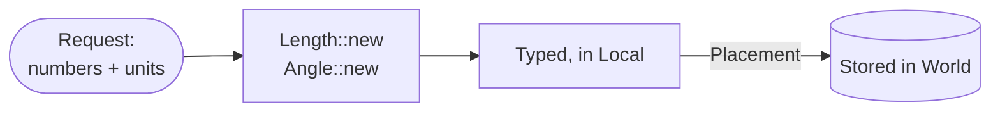

# Units

[Architecture](../ARCHITECTURE.md) › Units · crate `occam-units`

Numbers become quantities once, at the API. Inside, everything is typed and lives in one frame.

## The types

| Type | What it is |
|---|---|
| `Length`, `Angle`, `Point<F>` | Typed quantities in frame `F`. Stored positions, radii and deviations stay typed |
| `Vec3` | Three plain numbers for the inside of a formula, typed again at its ends |
| `Direction<F>` | A dimensionless unit axis |
| `Tangent<F>` | A derivative: length per unit of a parameter, which may be a length, an angle or a knot unit |
| `ParamKind` | What a parameter measures, so a test in parameter space uses the right tolerance |
| `Placement<A, B>` | A rigid map, built once with the owned `sin_cos` |
| `Bounds` | A box holding everything it bounds, rounding included |

## Tolerance

One length and one angle per model. Never per entity, never growing. The type has no default; a new model gets
[O12's](open-decisions.md#o12-the-default-tolerance).

| Method | Meaning |
|---|---|
| `band()` | What every decision compares with: `abs(q) <= eps` means on, tangent or the same |
| `near_tangent_shift(R)` | `sqrt(2 R eps)`: how far a near-tangent decision moves a vertex. Reported, never added to the vertex's radius |
| `in_parameter(kind, rate)` | The band in a parameter of that kind |

Evidence

- [S1](../evidence/2026-11-09-s1.md): the typed layer stopped where formulas began, hence `Vec3`. A box too small is a
  silent wrong answer (item 13), so every cull is tested against the unculled run's digest;
  [P8](../evidence/2026-11-09-p8.md) found a mis-ordered minimum only that way.
- [S4](../evidence/2026-11-09-s4.md): a tangent is not three lengths (A's `Tangent` was, A:5). S4's cone compared a
  length with an angle tolerance, hence `ParamKind`. Parameters stay bare numbers so lane kernels read plain `f64`.
- [S2](../evidence/2026-11-09-s2.md): adding the near-tangent shift to a vertex's radius brings back the hull S2's
  snapping drops: 86% of chain steps failing instead of 44% (A:2).

