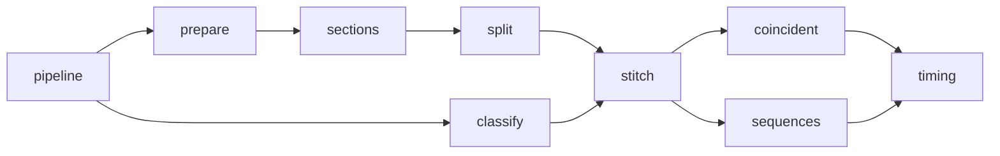

# Milestone: booleans

The seventh milestone of [the first release](first-release.md). Fuse, cut and common of solids, as
[the boolean](../architecture/boolean.md)'s seven pure phases over `intersection`'s sections. It also classifies a point
as inside, on or outside a solid or a face. Coincident faces are answered, not refused, and every result says which
input faces made which output faces. A failure names every failing pair and leaves the model unchanged. The design is
[the boolean](../architecture/boolean.md), [intersection](../architecture/intersection.md),
[reports](../architecture/reports.md) and [threads and lanes](../architecture/threads-and-lanes.md). Parity rows 1.11
and 2.14.

**Exit (gate):** `just gates`, `just mutants` and `just perf` are green, and:

- Every result returned as a success passes `commit`'s checker, in release builds too. Every shell is closed and meets
  Euler–Poincaré, and every group of four holds the volume identity
  `vol(A) + vol(B) = vol(A ∪ B) + vol(A ∩ B)` within the band.
- [S1](../evidence/2026-11-09-s1.md)'s 546 corpus cases, apart from the fillets, give no wrong answer. Each is
  answered, or reported with its code. Among those answered are the 32 that S1 reported as `coincident-surfaces`.
- The 26 cases OCCT gets wrong, in [`tools/oracle/divergences.json`](../../tools/oracle/divergences.json), are each
  right by the invariant that decides them, or reported as `boolean.below-resolution` or `decide.undecided` with a
  bound.
  None loses a solid without saying so. `near-crossed-internal-0009-intersection`, where OCCT drops a solid of about
  5099.7, gives that solid.
- A failure leaves the model's digest unchanged and reports every failing pair in candidate order, the first as the
  primary report.
- Results are the same bits at 1 and N threads, and on x86-64 and single-threaded wasm32 (L23).
- The nightly job runs seeded random sequences of booleans with no invariant failure. The milestone's PR runs 1,000
  sequences of up to eight operations clean.

**Exit (goal):**
- Success rate and speed against the OCCT oracle across the corpus (L46), with disagreements recorded by case,
  invariant and verdict, the way census records them.
- [S6](../evidence/2026-11-09-s6.md)'s boolean failures, rerun blind on the real kernel. S6's ten cases are rebuilt for
  the `occam` command, with every input number withheld, as in S6's blind control. Each case gets one fresh agent, one
  run, and acceptance rules written before any run, as in construction's blind run. The bar is S6's blind runs: 4 of 6
  on its reports, 6 of 6 enriched ([the risk](../architecture/risks.md)).
- The `Tally`'s share of decisions reaching the exact path across the corpus, against the risk's bound of about 1%.

**PR grouping:** every step shares one PR, with a commit each, as for the milestones before it.

**Throughout.** The boolean lives in `occam-ops` and reads sections through `occam-intersect` only. Each phase maps
frozen input to frozen output, and its output holds indices local to each item, never a model id
([P2](../evidence/2026-11-09-p2.md)). Only the stitch gives ids, inside one `Edit`, and only `commit` makes the result.
There is no cache: once order is explicit and edges are box-tested, a cache saves almost nothing
([P8](../evidence/2026-11-09-p8.md)). Threads go across items through `Exec`, as [threads and
lanes](../architecture/threads-and-lanes.md) assigns them. Every decision goes through `occam-math`'s predicates, and
every outcome carries its `Tally`.

Every operation [ships complete](first-release.md): request and result schema, codes with followed-remedy tests (L2),
command-line and wasm exposure, a `gates perf` bench and browser timing. Reports follow
[schema 2](../architecture/reports.md): fault class, stage, the tolerance in force, and where it failed and how close to
tangency it was (L5). Each method names its sources in [SOURCES.md](../SOURCES.md) when its code lands, each checked
against the source itself, since this plan cites them from memory. The sketch's `ops.rs` boolean is deleted at the end.

## Steps

### `booleans.pipeline`

`fuse`, `cut` and `common` as requests: an object and a tool, each a solid named by id, read and checked whole before
any geometry. The seven phases are stubs behind one runner. It collects each phase's failures per item in candidate
order, keeps every frozen output reached so the describer can name sections and regions, and leaves the input model
unchanged on failure. Every result carries its `Tally`. The operations are exposed through `occam run` and wasm.

*Failing test first:* a request naming a face, or a solid twice, is refused before any geometry, with the parameter's
path. With stub phases, an injected failure in phase 3 leaves the digest unchanged and reports every failing pair in
order, and the frozen outputs describe a section by id. The same request gives the same outcome at 1 and N threads.

### `booleans.prepare`

Phases 1 and 2. Only the faces whose bounds meet the other operand's box are prepared, with their trim polygons and
edge-to-face incidence. The rest keep their ids and generations ([P1](../evidence/2026-11-09-p1.md)). Candidate face
pairs come from a sort and sweep over conservative boxes, in stable order (Baraff 1992; Cohen, Lin, Manocha and Ponamgi
1995; Ericson 2005, ch. 7).

*Failing test first:* cutting a small tool from a plate of 10⁵ faces prepares only the faces near the tool, and its
cost in instructions follows the tool, not the plate; untouched faces keep their ids; candidate pairs are the same set,
in the same order, as all-pairs filtered by box; a box seeded one ulp too small changes a digest and is caught, as P8's
mis-ordered cylinder box was.

### `booleans.sections`

Phase 3's first round. One section per distinct surface pair, through `occam-intersect`; an edge against a face only
after its box test. A section's failures become boolean reports with the pair, the curves found, and the residual gap
(L5). `BelowResolution` becomes `boolean.below-resolution`, and an undecided decision becomes `decide.undecided`, each
with the separation against the radii or the plane's clearance, the band, and the remedies `move-apart` and
`use-tolerance`.

*Failing test first:* S1's near-tangent families are each answered or reported, none silently. S6's c04, crossed
cylinders offset by about the tolerance, reports the separation and the tolerance in force, and following
`move-apart` succeeds. The 11 near-tangent intersections in the divergence register are each answered with their
volume, or reported below resolution with a bound that holds it.

### `booleans.split`

Phases 4 and 5. Edges are split in three rounds, with the vertex table frozen between them: stops per edge, then pinch
vertices merged, then the clips ([P2](../evidence/2026-11-09-p2.md)). Faces are split one a task, in their own
parameters, as an arrangement of their trims and section pieces (de Berg, Cheong, van Kreveld and Overmars 2008,
ch. 2). A section piece that ends inside a face is `boolean.dangling-section`, with its end.

*Failing test first:* P2's `array` and `comb` give the same digest at 1, 2, 4 and 6 threads; a pinch vertex, where a
section touches an edge, is merged before any clip reads it; S1's `nurbs-near-peak` case 0082, which kept one piece
and dropped its partners, is answered or reported as dangling, never left open.

### `booleans.classify`

Phase 6, and parity row 2.14 as a query. A point against a solid: it is `on` when it lies within the band of a face.
Otherwise, a ray's crossings with the faces are counted through `intersection.hits`. When a hit is not certified
transversal, the ray is cast again along the next direction of a fixed sequence, and when no direction certifies, the
answer is `decide.undecided`. A point against a face: the exact winding number of its trims in parameters (Hormann and
Agathos 2001), or `on` within the band of the boundary. In the boolean, each region classifies one interior point
against the other operand, and the labels spread to untouched faces across edges that no section crosses (Requicha
and Voelcker 1985; Mäntylä 1988). `classify` is exposed as its own query.

*Failing test first:* points at a cube's vertices, edges and faces, and on a torus's seam, are `on`; a ray through an
edge does not flip the answer; a point inside a stepped shaft whose first ray grazes the step is `inside`; each region
of a crossed-cylinder cut is labelled, and the labels stop at section edges.

### `booleans.stitch`

Phase 7, sequential. One `Edit` builds the result, and `commit` checks it. Each output face derives from its input
face, so `Changes` says which input faces made which output faces (row 1.11). An empty result is a success with a
`boolean.empty-result` note giving the operands' separation ([reports](../architecture/reports.md)).

*Failing test first:* the bracket plate cut by a bolt-hole cylinder taller than the plate has volume `24000 − πr²h`,
and its hole wall derives from the cylinder's face; S6's c09, the common of two boxes that do not touch, is an empty
result with their separation, not a silent `ok`; a result the checker refuses is a failure, and the model is unchanged.

### `booleans.coincident`

Coincident faces, written test-first from S1's 32 reports and S6's c01 to c03
([O25](../decisions/2026-11-11-the-architecture-and-its-answers.md)). When a section reports two faces on one surface,
coplanar or coaxial, their overlap is found in the shared surface's parameters as a boolean of their trims (Greiner and
Hormann 1998; Martínez, Rueda and Feito 2009), periodic in angle on a cylinder. The overlap is `on`, with the same or
the opposite orientation (Tilove 1980). Each operation then keeps one copy, both, or neither, by the regularised table
(Requicha and Voelcker 1985).

*Failing test first:* S1's `box-slab` (12), `box-stacked` (8) and `coaxial-equal` (12) are answered, each right by its
closed form; S6's c01 to c03 succeed with no `move-apart`; the bracket's bolt-hole tool exactly as tall as the plate
cuts a through hole, as [the bracket test](../architecture/bracket-test.md) needs.

### `booleans.sequences`

Randomised sequences. A seeded generator builds sequences of up to eight fuses, cuts and commons over primitives,
sweeps and copies, placed at random, touching, coaxial and near-tangent included. Each result is held to the exit's
invariants. A failing sequence is shrunk to its shortest by delta debugging (Zeller and Hildebrandt 2002) and kept as a
regression test. It runs nightly, and 1,000 sequences run on the milestone's PR. The step's PR asks for a
property-test crate under O5, if the generator is better as one.

*Failing test first:* a seeded bug, an orientation flipped in the stitch, is found within the first 100 sequences and
shrunk to at most three operations.

### `booleans.timing`

The exit's measurements: `gates perf` classes for each phase and for the bracket's cut, with browser timing; boolean
digests in `gates determinism`; the corpus against the OCCT oracle; the divergence register's cases; the `Tally`'s
exact-path share; and S6's blind rerun.

*Failing test first:* each new class is `perf.unrecorded` until the record takes it, and the determinism probe fails
until boolean digests are in its stream.

## Open questions for the user

[O32](../PLAN.md#7-decisions-the-user-still-owns): an object and one tool per operation, or many tools in one? The
recommendation is one tool in the first release. Many tools are then a sequence, and a general fuse of many operands
comes later. P2 and S1 measured only the binary case.
