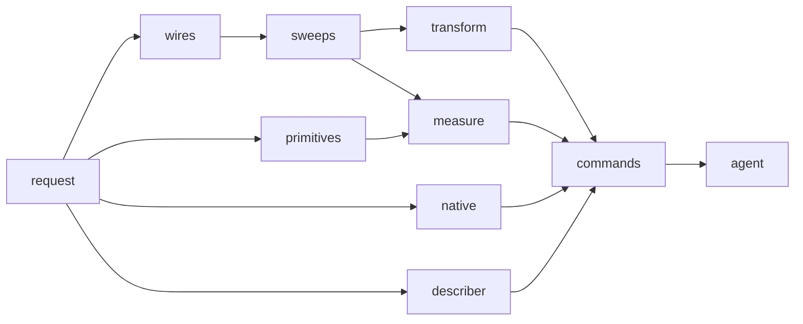

# Milestone: construction

The fourth milestone of [the first release](first-release.md). An agent can build and inspect a solid from JSON alone:
a request is checked and converted before any geometry, its steps make wires, faces, primitives, sweeps and copies
through `Edit`, every outcome says what it created, changed and deleted, and the `occam` command runs it, lists,
describes and checks the model, and saves it in the native format. The design is [operations](../architecture/operations.md),
[files](../architecture/files.md), [the command line](../architecture/command-line.md) and
[reports](../architecture/reports.md#how-an-agent-learns-what-an-entity-is). Parity rows 1.6, 1.8, 1.12, 1.13, 2.7, 2.11,
2.13, 2.15 and 2.17.

**Exit (gate):** `just gates`, `just mutants` and `just perf` are green, and the agent test passes: a solid built from
JSON alone through the `occam` command. **Exit (goal):** the time to load a model of 10⁵ faces, parsing and
`check_all` timed apart ([the files risk](../architecture/risks.md)).

**PR grouping:** every step shares one PR, with a commit each, as for the milestones before it.

**Throughout.** Every operation [ships complete](first-release.md): its request and result schema, codes with
followed-remedy tests, command-line and wasm exposure, invariant checks (every success passes `commit`'s checker, in
release builds too), a bench in `gates perf` and browser timing. New crates `occam-ops` and `occam-io` take their
places in [the layers](../PLAN.md#4-layers); `serde` and `serde_json` are
[already allowed](../decisions/2026-11-09-serde.md), and nothing else new is expected. Each step moves what it makes
real out of [the type sketch](../sketch/src/lib.rs).

## Steps

### `construction.request`

`occam-ops` with the request: its schema version, units, an optional tolerance, and steps, each with an optional label
a later step can name as an operand. It is checked and converted once, before any geometry, with a code per kind of
bad input naming the operation, parameter, value and rule (`input.invalid-parameter`, S6). The runner in `occam` runs
the steps in order through `Edit`, stops at the first failure with the model after the last good step, and gives each
step's outcome: the ids it created, changed and deleted, and the tolerance in force. An operation the first release does
not have is refused by name, and a listing says what is supported and what is refused.

*Failing test first:* each kind of bad input gets its code naming the parameter, value and rule, with a test that
follows its remedy; an unknown operation is refused by name; a failing step leaves the model as the last good step
left it, and a new model takes the request's tolerance or the default and says which.

### `construction.wires`

Edges from points, lines and arcs; a wire from edges, a gap reported by where it is; a planar face from a closed wire,
with holes (row 1.6). Vertices are shared by identity and merged by the band as they are made (S1 item 1); each face
gets its parameter curves and a witness for each loop.

*Failing test first:* a rectangle with a round hole becomes one face that passes the checker; a wire with a gap is
refused naming the two ends and the gap; a hole outside its face, and a wire that crosses itself, are refused.

### `construction.primitives`

Box, cylinder, sphere, cone, torus and wedge at a given frame (rows 1.12, 2.13), each a closed solid whose periodic
surfaces are split into chart-sized patches with seams as real edges, and whose poles and apex are vertices.

*Failing test first:* each primitive passes the checker with its expected counts of faces, edges and vertices and a
genus of 0 (1 for the torus); a size that is not positive is refused with its parameter.

### `construction.sweeps`

Extrude a face along a vector into a solid, and revolve a face or a wire about an axis into a solid or a sheet (rows
1.13, 2.15), with provenance: the profile's entities and those made from them.

*Failing test first:* the extruded rectangle with a hole is a solid of genus 1 that passes the checker; a full
revolution of a rectangle off its axis is a torus-like solid of genus 1; an extrusion along a vector in the face's
plane is refused.

### `construction.transform`

Rigid and scaling transforms of a body, and a copy whose ids are new and distinct, with lineage to what it copied
(row 2.11).

*Failing test first:* a copied box moved by a vector has new ids, the same counts, and its lineage names the original;
a scale that is not positive is refused.

### `construction.measure`

Volume, surface area and centre of mass of a solid by the divergence theorem over its faces, with adaptive quadrature
(row 1.8), and the tight axis-aligned box of any body (row 2.7).

*Failing test first:* the closed forms of each primitive and of the extruded and revolved solids, within the
quadrature's stated tolerance; the box of a rotated cylinder is tight, not its bounding box's box.

### `construction.native`

`occam-io`: save and load in the native format, the readable dump itself (row 2.17). JSON with every finite number
exact, versioned from the first commit, holding the tolerance, the step counter and every slot's generation, so a
loaded model has the same ids and digest. Loading trusts nothing: it measures and checks the whole model, as `commit`
would. Bytes at the seam (`Vec<u8>`, `&[u8]`).

*Failing test first:* every clean model round-trips to the same digest; a saved file with one record corrupted is
refused naming it; a file of another version is refused with its version.

### `construction.describer`

The one resolver ([O26](../architecture/open-decisions.md#o26-how-an-agent-learns-what-an-entity-is)): `describe_all`
in `occam` describes every id in a result as it leaves the kernel, in one batch, with form, values in the caller's
units, extent and position, origin (the step and its part in it) and neighbours.

*Failing test first:* every report and outcome that leaves the kernel has a description for each id it names; an edge
made by an extrusion is described as a line with its ends in the request's units, made by that step as a profile.

### `construction.commands`

`occam run`, `list`, `adjacent`, `describe` and `check`, each with `--json`, many ids and one result per id; `run`
exposed in wasm too. Saving and loading go through the native format.

*Failing test first:* each command's JSON for a known model; an unknown id is `topo.stale-id` for that id alone, the
others answered.

### `construction.agent`

The exit test: a solid built from JSON alone through the `occam` command, the bracket test's plate with its cylinder
beside it, then listed, described, measured and checked. A blind run by an agent given only the command and its
reports is recorded as a goal, as S6's were. The time to load 10⁵ faces is measured, parsing and checking apart.

*Failing test first:* the test drives the built binary with JSON files only, and fails until every command it uses
exists.
