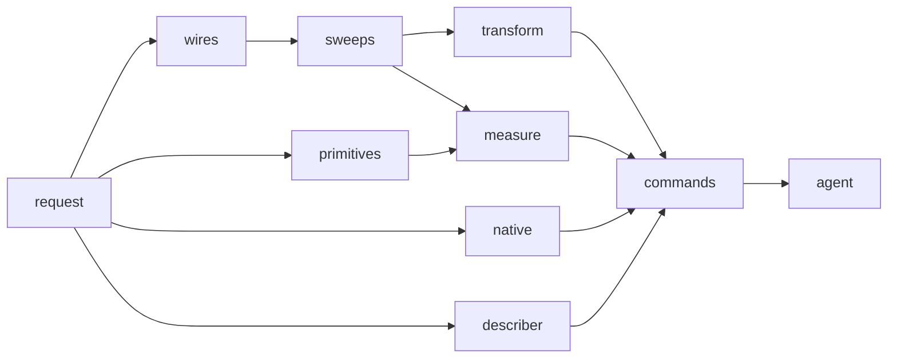

# Milestone: construction

The fourth milestone of [the first release](first-release.md). An agent can build and inspect a solid from JSON alone:
a request is checked and converted before any geometry, its steps make wires, faces, primitives, sweeps and copies
through `Edit`, every outcome says what it created, changed and deleted, and the `occam` command runs it, lists,
describes and checks the model, and saves it in the native format. The design is [operations](../architecture/operations.md),
[files](../architecture/files.md), [the command line](../architecture/command-line.md) and
[reports](../architecture/reports.md#how-an-agent-learns-what-an-entity-is). Parity rows 1.6, 1.8, 1.12, 1.13, 2.7, 2.11,
2.13, 2.15 and 2.17.

**Exit (gate):** `just gates`, `just mutants` and `just perf` are green, and the agent test passes: a solid built from
JSON alone through the `occam` command. **Exit (goal):** the time to load a model of 10⁵ faces, parsing and
`check_all` timed apart ([the files risk](../architecture/risks.md)).

**PR grouping:** every step shares one PR, with a commit each, as for the milestones before it.

**Throughout.** Every operation [ships complete](first-release.md): its request and result schema, codes with
followed-remedy tests, command-line and wasm exposure, invariant checks (every success passes `commit`'s checker, in
release builds too), a bench in `gates perf` and browser timing. New crates `occam-ops` and `occam-io` take their
places in [the layers](../PLAN.md#4-layers); `serde` and `serde_json` are
[already allowed](../decisions/2026-11-09-serde.md), and `postcard` was [added](../decisions/2026-11-12-binary-twin.md)
for the native format's binary twin. Each step moves what it makes real out of [the type sketch](../sketch/src/lib.rs).

## Steps

### `construction.transform`

Rigid and scaling transforms of a body, and a copy whose ids are new and distinct, with lineage to what it copied
(row 2.11).

*Failing test first:* a copied box moved by a vector has new ids, the same counts, and its lineage names the original;
a scale that is not positive is refused.

### `construction.measure`

Volume, surface area and centre of mass of a solid by the divergence theorem over its faces, with adaptive quadrature
(row 1.8), and the tight axis-aligned box of any body (row 2.7).

*Failing test first:* the closed forms of each primitive and of the extruded and revolved solids, within the
quadrature's stated tolerance; the box of a rotated cylinder is tight, not its bounding box's box.

### `construction.commands`

`occam run`, `list`, `adjacent`, `describe` and `check`, each with `--json`, many ids and one result per id; `run`
exposed in wasm too. Saving and loading go through the native format.

*Failing test first:* each command's JSON for a known model; an unknown id is `topo.stale-id` for that id alone, the
others answered.

### `construction.agent`

The exit test: a solid built from JSON alone through the `occam` command, the bracket test's plate with its cylinder
beside it, then listed, described, measured and checked. A blind run by an agent given only the command and its
reports is recorded as a goal, as S6's were. The time to load 10⁵ faces is measured, parsing and checking apart, from
the binary twin and from JSON.

*Failing test first:* the test drives the built binary with JSON files only, and fails until every command it uses
exists.
