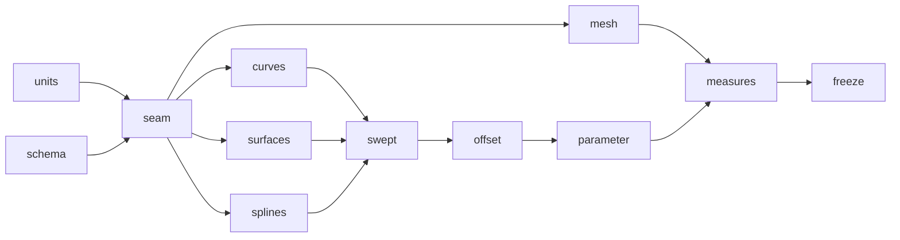

# Milestone: geometry

The second milestone of [the first release](first-release.md). A new crate, `occam-geom`, holds every curve and surface
family [PARITY](../PARITY.md) places here, behind the two-layer seam of [the geometry topic](../architecture/geometry.md):
a family implements `Parametric` over `Real`, and everything else calls `Surface`. `occam-units` gains
[its new types](../architecture/units.md) and `occam-report` [schema 2](../architecture/reports.md#what-changes-in-schema-2).
Parity rows 1.2 (the rest), 1.3, 1.4, 1.5, 2.1 to 2.4 and 2.8.

**Exit (gate):** `just gates`, `just mutants` and `just perf` are green; [S4's](../evidence/2026-11-09-s4.md)
conformance suite passes over every family, analytic, B-spline and mesh-backed (L21); then the seam is frozen.

**PR grouping:** every step shares one PR, with a commit each, as for [`maths`](maths.md).

**Throughout.** Each family passes the conformance suite in the step that adds it, and joins its batch kernel to the
vectorisation check where it has one. Geometry is stored in `World`. No new dependency is expected.

## Steps

### `geometry.schema`

Report schema 2: `EntityRef` with kind, slot and generation in one text form (`edge:41/1`) and the new kinds, the fault
class, the closed list of reasons, the stage, a named value that holds a point, the tolerance in force, and the geometry
codes with their remedies. A report of schema 1 is refused with `use-schema`.

*Failing test first:* a schema 2 report round-trips through JSON with a point value and every new field; each new code
and remedy pair has a followed-remedy test (L2).

### `geometry.seam`

`occam-geom` with `Parametric` and `Surface`, `ParametricCurve` and `Curve`, and `ParamCurve`: evaluation by order,
`derivatives` to any order, `eval_batch` with caller-owned scratch through `dispatch`, `invert` and `closest` that say
where they stopped, domains, degeneracies, `family`, `batch_key`, `content` and `shape`, and the presentation defaults.
The conformance suite, S4's eight checks, as one harness any family runs. The plane and the line.

*Failing test first:* the suite fails on a plane and a line seeded with a wrong second derivative, and passes on the
real ones; a source check finds no family named outside its own module and no downcast.

### `geometry.curves`

Circles, ellipses, hyperbolas and parabolas, trimmed by parameter, to any derivative, with closed-form `invert` and
`closest` where one exists (rows 1.4, 2.1).

*Failing test first:* the suite over each family, and closed-form points and derivatives at named parameters.

### `geometry.surfaces`

Cylinders, cones, spheres and tori, with their seams and their degeneracies (a sphere's poles, a cone's apex), in lanes
through the owned `sin_cos` and `atan2` (row 1.5).

*Failing test first:* the suite over each family, including points on each seam and at each degenerate line.

### `geometry.splines`

B-spline and Bézier curves and surfaces, rational or not: evaluation and derivatives to any order, `eval_batch` in lanes
at a measured width, and `to_bspline` for the analytic families (rows 2.1, 2.2).

*Failing test first:* the suite over each family; the analytic families converted to B-spline agree with themselves
within the band; the spline kernel beats width 1 in `gates perf`.

### `geometry.mesh`

Mesh-backed surfaces: a triangle set that answers the same questions, its derivatives only where they exist, and
`triangles` as its presentation.

*Failing test first:* the suite over a mesh-backed surface, finite differences stopping at the first derivative (S4).

### `geometry.swept`

Surfaces of revolution and of linear extrusion, of any curve (row 2.2).

*Failing test first:* the suite over each, swept from every curve family; a revolved line is a cylinder or a cone and an
extruded circle a cylinder, within the band.

### `geometry.offset`

Offset and trimmed curves and surfaces, of any family; the offset's normal derivative from do Carmo (rows 2.1, 2.2).

*Failing test first:* the suite over each; the offset of a plane, a cylinder and a sphere is the expected analytic
surface within the band.

### `geometry.parameter`

Curves in a face's parameter space, with the same kinds as in 3D, and their joining to 3D edges (row 2.3).

*Failing test first:* the suite's curve checks over each kind in parameter space; a parameter curve on each surface
family agrees with its 3D edge within the band, and one that does not is reported.

### `geometry.measures`

Tangent, normal and curvature at a parameter (row 2.8); curve length and a uniform discretisation by distance or by
deflection (row 2.1); continuity classes C0 to CN, G1 and G2, reported and required at joins (row 2.4).

*Failing test first:* known lengths and curvatures for every analytic family; a discretisation never further from the
curve than asked; continuity at known joins, and a join below what was required reported.

### `geometry.freeze`

The suite runs over every family in one table, the seam is frozen (L21), and the type sketch's `geom.rs`, `units.rs`
and schema 2's part of `report.rs` are deleted. A changed seam signature then fails a test until a decision allows it.

*Failing test first:* a seam signature changed on purpose fails the freeze test.
