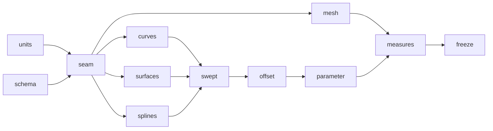

# Milestone: geometry

The second milestone of [the first release](first-release.md). A new crate, `occam-geom`, holds every curve and surface
family [PARITY](../PARITY.md) places here, behind the two-layer seam of [the geometry topic](../architecture/geometry.md):
a family implements `Parametric` over `Real`, and everything else calls `Surface`. `occam-units` gains
[its new types](../architecture/units.md) and `occam-report` [schema 2](../architecture/reports.md#what-changes-in-schema-2).
Parity rows 1.2 (the rest), 1.3, 1.4, 1.5, 2.1 to 2.4 and 2.8.

**Exit (gate):** `just gates`, `just mutants` and `just perf` are green; [S4's](../evidence/2026-11-09-s4.md)
conformance suite passes over every family, analytic, B-spline and mesh-backed (L21); then the seam is frozen.

**PR grouping:** every step shares one PR, with a commit each, as for [`maths`](maths.md).

**Throughout.** Each family passes the conformance suite in the step that adds it, and joins its batch kernel to the
vectorisation check where it has one. Geometry is stored in `World`. No new dependency is expected.

## Steps

### `geometry.measures`

Tangent, normal and curvature at a parameter (row 2.8); curve length and a uniform discretisation by distance or by
deflection (row 2.1); continuity classes C0 to CN, G1 and G2, reported and required at joins (row 2.4).

*Failing test first:* known lengths and curvatures for every analytic family; a discretisation never further from the
curve than asked; continuity at known joins, and a join below what was required reported.

### `geometry.freeze`

The suite runs over every family in one table, the seam is frozen (L21), and the type sketch's `geom.rs`, `units.rs`
and schema 2's part of `report.rs` are deleted. A changed seam signature then fails a test until a decision allows it.

*Failing test first:* a seam signature changed on purpose fails the freeze test.
