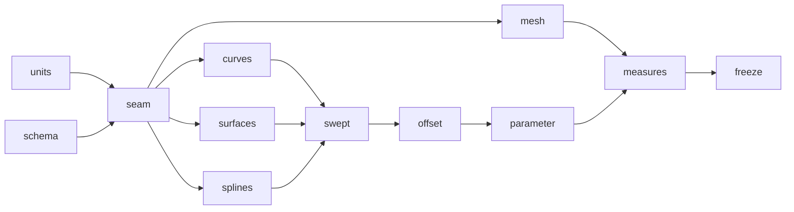

# Milestone: geometry

The second milestone of [the first release](first-release.md). A new crate, `occam-geom`, holds every curve and surface
family [PARITY](../PARITY.md) places here, behind the two-layer seam of [the geometry topic](../architecture/geometry.md):
a family implements `Parametric` over `Real`, and everything else calls `Surface`. `occam-units` gains
[its new types](../architecture/units.md) and `occam-report` [schema 2](../architecture/reports.md#what-changes-in-schema-2).
Parity rows 1.2 (the rest), 1.3, 1.4, 1.5, 2.1 to 2.4 and 2.8.

**Exit (gate):** `just gates`, `just mutants` and `just perf` are green; [S4's](../evidence/2026-11-09-s4.md)
conformance suite passes over every family, analytic, B-spline and mesh-backed (L21); then the seam is frozen.

**PR grouping:** every step shares one PR, with a commit each, as for [`maths`](maths.md).

**Throughout.** Each family passes the conformance suite in the step that adds it, and joins its batch kernel to the
vectorisation check where it has one. Geometry is stored in `World`. No new dependency is expected.

## Steps

Every step is done; the exit gate above is checked on the milestone's PR.
