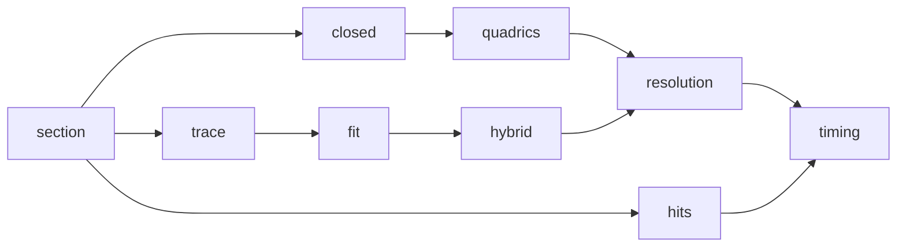

# Milestone: intersection

The sixth milestone of [the first release](first-release.md), [open together with
`view`](../decisions/2026-11-15-view-and-intersection-together.md). A new crate, `occam-intersect`, finds where two
surfaces meet and where a curve crosses a surface, for `booleans` to use. It tries closed forms first, then Levin's
pencil method for the other quadric pairs, then the hybrid, and it keeps every failure beside what was found. A loop too
small to resolve is reported as one, and coincident surfaces are detected. The design is
[intersection](../architecture/intersection.md), [the boolean](../architecture/boolean.md) phase it serves, and [robust
decisions](../architecture/maths.md#robust-decisions). No parity row: PARITY places intersection as a query (row 3.4)
and sections (row 3.2) later.

**Exit (gate):** `just gates`, `just mutants` and `just perf` are green, and:

- [P5's](../evidence/2026-11-09-p5.md) 110 cases, rebuilt as tests with answers known by construction, give no silent
  failure. At least 107 are correct, P5's count for closed forms then the hybrid. Each of the rest is a reported
  failure or `BelowResolution`.
- Every quadric pair in P5's set and in a generated set is intersected exactly by the pencil method. Each curve lies on
  both surfaces within the band. Each degenerate pencil, whether a tangency, a singular point or a split into lines
  and conics, is detected and classified, never fitted.
- Swapping a pair's arguments gives the same section, with its two images swapped.
- Sections and hits are the same bits at 1 and N threads, on x86-64 and on single-threaded wasm32.
- On the corpus, the edge box test leaves every digest as the unculled run gives it
  ([P8](../evidence/2026-11-09-p8.md)).

**Exit (goal):** agreement with the closed forms and with the OCCT oracle across the corpus. Disagreements are recorded
the way census records them, by case, invariant and verdict. A held-out set, generated after the code is frozen, is
scored as P5 scored, since P5's counts are in-sample. P5's speed table is rerun on the real code.

**PR grouping:** a step merges in its own PR ([small PRs](../decisions/2026-11-14-steps-merge-in-small-prs.md)).

**Throughout.** `occam-intersect` takes its place in [the layers](../PLAN.md#4-layers), between `occam-geom` and
`occam-topo`. It is std-only, computes through `occam-math`, and runs in parallel only through `Exec`. It works on
surfaces and curves and knows nothing of faces or ids. It reads surfaces through the frozen seam only: `analytic`,
`bounds`, `domain`, `degeneracies`, `closest` and evaluation. The hybrid needs no B-spline form, so offsets and
mesh-backed surfaces reach it. Curves present no analytic form, and none is needed. The curve family the pencil method
adds, and the image family it reads it through, fit the frozen traits, so the seam does not change.

Every decision goes through `occam-math`'s predicates. An undecided one is `decide.undecided`, and every result carries
its `Tally`. Threads go across pairs, and across traces in rounds of a fixed size merged by index. Marching stays
scalar, and no lane kernel is planned: P5 measured lane kernels at 3.5 to 12% of a run, and four lanes 22 to 28% slower
than one for marching. Intersection is not an operation an agent calls, so it has no command or schema of its own.
`booleans` carries its reports to the agent, and the remedies here are followed in the crate's own tests (L2). Each
method names its sources in [SOURCES.md](../SOURCES.md) when its code lands, from P5's list, each checked against the
source itself: P5 cited them from memory. The sketch's `intersect.rs` is deleted at the end.

## Steps

### `intersection.fit`

Traced points become curves. A section curve is a B-spline fitted to the trace (Piegl and Tiller 1997, ch. 9), with
its fit recorded in `Curve::fit`, and so are its images on both surfaces. This adds a fitted family to `occam-geom`,
which passes the conformance suite like every other family. The seam does not change.

*Failing test first:* every fitted curve lies within its recorded fit of both surfaces, at samples denser than the
trace's; its images map onto it within the band; a fit that cannot reach the band is reported with what it reached.

### `intersection.hybrid`

The general method: subdivision for start points, then the trace. A breadth-first traversal splits parameter boxes and
rejects pairs whose `bounds` miss each other, with a rounding margin (Lane and Riesenfeld 1980; Houghton et al. 1985;
Barnhill and Kersey 1990). Where one side is analytic, a pair is also rejected when that side's implicit function cannot
change sign over the other's box ([P8](../evidence/2026-11-09-p8.md)). Each leaf gives at most one start point. Points
are cached and filtered in parallel, and duplicates are found within a tube as wide as the chord's sag, or
`sqrt(tolerance)` near a tangency. A leaf the budget cannot resolve is reported. Lattice seeding alone is not offered,
because it returned 256 of 577 curves with no warning.

*Failing test first:* P5's 625-component surface against a plane gives all 577 curves; a curve through a corner shared
by both subdivisions is found once; a rational cylinder against its analytic twin is reported as an unresolved overlap,
not answered with curves; the output is the same bits at 1 and N threads.

### `intersection.resolution`

What the tolerance cannot tell apart (O24). A loop smaller than `d` comes back as `BelowResolution { at, bound }`,
where `d` follows from the band and the surfaces' relative curvature at the contact (P5: loop radius about `sqrt(eps)`).
A tangent contact is a `Contact::Point` only when the decision certifies it. Branch points, where two branches of the
section cross, split the curves there and are kept as contacts, where P5 passed through them.

*Failing test first:* P5's near-tangent sweep, 48 cases from a gap of 1e-1 to 1e-12, each correct or `BelowResolution`
with a bound that contains the true loop, and never silent. `nt_poly_loop` at 1e-10, P5's one silent failure, is
`BelowResolution`. The Viviani node splits its curve.

### `intersection.hits`

A curve over a range against a surface. The curve's box over the range is tested against the surface's first. Against
an analytic surface, the roots of its implicit function along the curve are isolated by interval bounds over subranges
(Rump 1999). Otherwise the range and the domain are subdivided together by their bounds, and Newton runs on the leaves.
A touch is a contact. A curve lying in the surface is reported as an overlap over its subrange, which `booleans` needs
for edges on coincident faces. A box test must be conservative, so the culled and unculled runs are compared by digest.

*Failing test first:* a line through a cylinder gives two hits and a tangent line one contact; a circle lying in a plane
is an overlap; on the corpus, the box test removes scans and changes no digest; a box seeded one ulp too small changes
a digest and is caught, as P8's mis-ordered cylinder box was.

### `intersection.timing`

The exit's measurements: `gates perf` classes for the closed forms, the pencil method, the hybrid and hits, with browser
timing; sections join `gates determinism`; P5's speed table on the real code, the closed forms per pair and the hybrid's
scaling at 1 to 6 threads (P5: 3.0 to 5.2 times); the held-out set scored; and the oracle comparison across the corpus.

*Failing test first:* each new class is `perf.unrecorded` until the record takes it; the determinism probe fails until
sections are in its stream.

## Open questions for the user

None is open. [O31](../decisions/2026-11-13-quadric-pairs-exact-by-levins-method.md) is answered: quadric pairs with
no closed form are intersected exactly, by Levin's pencil method.
