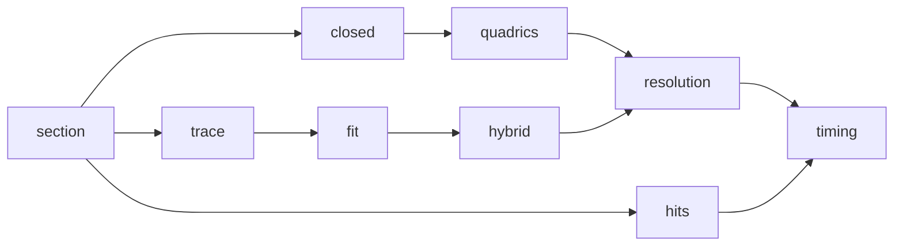

# Milestone: intersection

The sixth milestone of [the first release](first-release.md), [open together with
`view`](../decisions/2026-11-15-view-and-intersection-together.md). A new crate, `occam-intersect`, finds where two
surfaces meet and where a curve crosses a surface, for `booleans` to use. It tries closed forms first, then Levin's
pencil method for the other quadric pairs, then the hybrid, and it keeps every failure beside what was found. A loop too
small to resolve is reported as one, and coincident surfaces are detected. The design is
[intersection](../architecture/intersection.md), [the boolean](../architecture/boolean.md) phase it serves, and [robust
decisions](../architecture/maths.md#robust-decisions). No parity row: PARITY places intersection as a query (row 3.4)
and sections (row 3.2) later.

**Exit (gate):** `just gates`, `just mutants` and `just perf` are green, and:

- [P5's](../evidence/2026-11-09-p5.md) 110 cases, rebuilt as tests with answers known by construction, give no silent
  failure. At least 107 are correct, P5's count for closed forms then the hybrid. Each of the rest is a reported
  failure or `BelowResolution`.
- Every quadric pair in P5's set and in a generated set is intersected exactly by the pencil method. Each curve lies on
  both surfaces within the band. Each degenerate pencil, whether a tangency, a singular point or a split into lines
  and conics, is detected and classified, never fitted.
- Swapping a pair's arguments gives the same section, with its two images swapped.
- Sections and hits are the same bits at 1 and N threads, on x86-64 and on single-threaded wasm32.
- On the corpus, the edge box test leaves every digest as the unculled run gives it
  ([P8](../evidence/2026-11-09-p8.md)).

**Exit (goal):** agreement with the closed forms and with the OCCT oracle across the corpus. Disagreements are recorded
the way census records them, by case, invariant and verdict. A held-out set, generated after the code is frozen, is
scored as P5 scored, since P5's counts are in-sample. P5's speed table is rerun on the real code.

**PR grouping:** a step merges in its own PR ([small PRs](../decisions/2026-11-14-steps-merge-in-small-prs.md)).

**Throughout.** `occam-intersect` takes its place in [the layers](../PLAN.md#4-layers), between `occam-geom` and
`occam-topo`. It is std-only, computes through `occam-math`, and runs in parallel only through `Exec`. It works on
surfaces and curves and knows nothing of faces or ids. It reads surfaces through the frozen seam only: `analytic`,
`bounds`, `domain`, `degeneracies`, `closest` and evaluation. The hybrid needs no B-spline form, so offsets and
mesh-backed surfaces reach it. Curves present no analytic form, and none is needed. The two families the pencil method
adds fit the frozen traits, so the seam does not change.

Every decision goes through `occam-math`'s predicates. An undecided one is `decide.undecided`, and every result carries
its `Tally`. Threads go across pairs, and across traces in rounds of a fixed size merged by index. Marching stays
scalar, and no lane kernel is planned: P5 measured lane kernels at 3.5 to 12% of a run, and four lanes 22 to 28% slower
than one for marching. Intersection is not an operation an agent calls, so it has no command or schema of its own.
`booleans` carries its reports to the agent, and the remedies here are followed in the crate's own tests (L2). Each
method names its sources in [SOURCES.md](../SOURCES.md) when its code lands, from P5's list, each checked against the
source itself: P5 cited them from memory. The sketch's `intersect.rs` is deleted at the end.

## Steps

### `intersection.quadrics`

Levin's pencil method, for any two of plane, sphere, cylinder and cone that `intersection.closed` does not answer
([decision](../decisions/2026-11-13-quadric-pairs-exact-by-levins-method.md)). Each surface's `analytic` form gives its
4×4 matrix, and the two span a pencil. A ruled member of the pencil, such as a cylinder, a cone, a pair of planes or a
hyperbolic paraboloid, is found from the roots of the pencil's determinant. Along each of its rulings the other surface
gives a quadratic, so the curve is `a(u) ± b(u)√Δ(u)` (Levin 1976, 1979).

The pencil is classified first, by the real roots of its determinant, their multiplicities and the ranks there (Dupont,
Lazard, Lazard and Petitjean 2008, parts II and III; Wang, Goldman and Tu 2003):
- A smooth quartic is parametrized by the square root.
- A singular quartic, whose node or cusp is a crossing or a tangency, is parametrized rationally, and so is a pencil
  that splits into lines and conics. Their singular points are kept as contacts.

Every decision in the classification goes through `occam-math`'s predicates on the matrices' entries. One the band
cannot decide is `decide.undecided`, never a guess. Roots are isolated and refined by Newton on the owned maths, with no
new transcendental function.

The curves are exact: closed forms evaluated in floating point.
- A loop of a smooth quartic becomes a new `occam-geom` curve family. It is reparametrized so that the root's two signs
  join smoothly where `Δ` vanishes: by an angle between two roots for a closed loop, and by `u = u₀ + t²` for a branch
  from one root to infinity. It is then smooth, periodic or open, with derivatives to any order, and fits the frozen
  `ParametricCurve`. Its `to_bspline` gives none, because a smooth quartic has no rational form.
- Its images on the two surfaces, read through each quadric's closed-form inverse, are a new family under the frozen
  parameter-curve trait. So the seam does not change.
- Lines and conics use the existing families, and singular quartics use rational B-splines.

Still through the hybrid: a torus outside `intersection.closed`'s cases, a quadric against any other family, and every
pair with a NURBS.

*Failing test first:* every quadric pair in P5's set is intersected exactly, and so is a seeded generated set under
rigid placements with every degenerate class built in by construction:
- two equal cylinders whose axes cross split into two ellipses;
- Viviani's sphere and cylinder meet in a nodal quartic;
- two cones with a shared apex meet in lines;
- a cone and a cylinder are tangent along a ruling.

Each curve lies on both surfaces within the band at dense samples, and its images map onto it within the band. Each
degenerate pencil is classified as built, and none is fitted. Where a closed form also answers, the two agree within
the band. A pencil nudged to within the band of a split is `decide.undecided`.

### `intersection.resolution`

What the tolerance cannot tell apart (O24). A loop smaller than `d` comes back as `BelowResolution { at, bound }`,
where `d` follows from the band and the surfaces' relative curvature at the contact (P5: loop radius about `sqrt(eps)`).
A tangent contact is a `Contact::Point` only when the decision certifies it. Branch points, where two branches of the
section cross, split the curves there and are kept as contacts, where P5 passed through them.

*Failing test first:* P5's near-tangent sweep, 48 cases from a gap of 1e-1 to 1e-12, each correct or `BelowResolution`
with a bound that contains the true loop, and never silent. `nt_poly_loop` at 1e-10, P5's one silent failure, is
`BelowResolution`. The Viviani node splits its curve.

### `intersection.timing`

The exit's measurements: `gates perf` classes for the closed forms, the pencil method, the hybrid and hits, with browser
timing; sections join `gates determinism`; P5's speed table on the real code, the closed forms per pair and the hybrid's
scaling at 1 to 6 threads (P5: 3.0 to 5.2 times); the held-out set scored; and the oracle comparison across the corpus.

*Failing test first:* each new class is `perf.unrecorded` until the record takes it; the determinism probe fails until
sections are in its stream.

## Open questions for the user

None is open. [O31](../decisions/2026-11-13-quadric-pairs-exact-by-levins-method.md) is answered: quadric pairs with
no closed form are intersected exactly, by Levin's pencil method.
