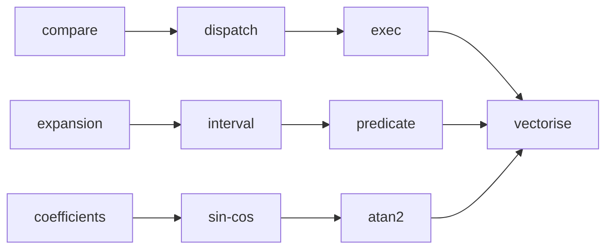

# Milestone: maths

The first milestone of [the first release](first-release.md). `occam-math` gains what every later crate computes with:
comparison and selection in lanes, dispatch to the widest instruction level, the execution layer, robust decisions, and
its own `sin_cos` and `atan2`. The design is [the maths topic](../architecture/maths.md) and
[threads and lanes](../architecture/threads-and-lanes.md); the contract is [DETERMINISM.md](../DETERMINISM.md).

**Exit (gate):** `just gates`, `just mutants` and `just perf` are green; `gates determinism` gives the same bits across
targets, thread counts and dispatch levels, the owned functions included, against hashes from a separate
implementation; and the vectorisation check in `gates perf` holds every lane kernel.

**PR grouping:** every step shares one PR, with a commit each, so that CI runs once (the user's request, 2026-11-11).

**Throughout.** `f64::sin`, `f64::atan2` and the rest stay banned. New dependencies are the two already approved,
[`fearless_simd`](../decisions/2026-11-10-fearless-simd.md) and [`rayon`](../decisions/2026-11-10-rayon.md), each named
only in `occam-math`. Randomised tests draw from the crate's own `SplitMix64`, so they draw the same cases on every
target. The determinism stream's separate implementation joins `tools/determinism/`, in Python's standard library, and
every step that changes the stream re-derives the record from it first.

## Steps

### `maths.interval`

`Interval<R>`, Rump's (1999) midpoint and radius, made outward without rounding modes by stepping each bound to the
next double: `+ - * /` and `sqrt`.

*Failing test first:* for random intervals and points inside them, the exact result, checked with `Expansion`, lies
inside the computed interval.

### `maths.predicate`

`Ring`, `Predicate<N>`, `Side`, `Verdict` and `Tally`. `decide_stored` runs the interval filter in `Lanes<4>` and the
exact stage for what it cannot certify. `decide_computed` answers `Undecided` when an enclosure straddles the band's
edge. [DETERMINISM.md](../DETERMINISM.md) gains S5's fourth statement: no computed value is compared with exactly zero.

*Failing test first:* on near-degenerate orientation inputs, `decide_stored` agrees with the exact sign every time; on
ordinary inputs the tally shows no exact fallback; a straddling enclosure is `Undecided`.

### `maths.coefficients`

`tools/coefficients/`, in Python's standard library with exact fractions: minimax fits for the `sin`, `cos` and `atan`
kernels, π/2 split for Cody and Waite's reduction, and the bits of 2/π for Payne and Hanek's. It writes one Rust file,
which `tools-test` checks is up to date. [The coefficients are our own](../decisions/2026-11-11-own-coefficients.md).

*Failing test first:* each fit's error on a dense grid is within its target, and the constants match values computed
independently to 120 digits.

### `maths.sin-cos`

The owned `sin_cos`, `sin` and `cos` over `Real`: Cody and Waite reduction below about 1.6e6, Payne and Hanek above,
and the fitted kernels. The Python twin computes the same bits, and the stream gains them.
[DETERMINISM.md](../DETERMINISM.md) gains S5's first three statements.

*Failing test first:* the stream's new hashes match the twin's record; within 0.75 ulps on S5's sets, measured by the
twin against a 120-digit reference; special values exact.

### `maths.atan2`

The owned `atan2` over `Real`, in the same way, with C99's special cases.

*Failing test first:* as for `maths.sin-cos`, within 1.5 ulps, and every signed zero and infinity case.

### `maths.vectorise`

The vectorisation check in `gates perf`: every lane kernel (comparison masks, the predicate filter, `sin_cos` and
`atan2`) beats width 1 at its chosen width on x86-64 by instruction count and in the browser with simd128, or runs at
width 1. The type sketch's `math.rs` is deleted.

*Failing test first:* a lane kernel seeded to run scalar fails the check.
