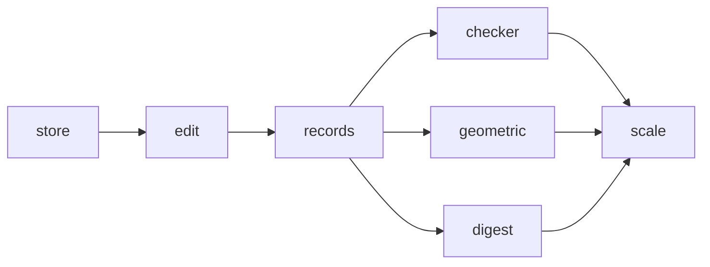

# Milestone: topology

The third milestone of [the first release](first-release.md). A new crate, `occam-topo`, holds the B-rep of
[the topology topic](../architecture/topology.md): records in copy-on-write chunks read through per-kind views, ids of
slot and generation, provenance, and `Edit`, whose `commit` runs the checker and is the only way to make a snapshot,
handing back `Changes` with each new entity's lineage. Parity rows 1.1 and 1.10.

**Exit (gate):** `just gates`, `just mutants` and `just perf` are green; the Euler and closure checks pass on every
model the tests build, and every seeded corruption is caught and named by its entities. **Exit (goal):**
[S3-P3's](../evidence/2026-11-09-s3-p3.md) snapshot and edit benchmarks at 10⁶ faces, on the real records, reported
beside the spike's numbers.

**PR grouping:** every step shares one PR, with a commit each, as for [`maths`](maths.md) and
[`geometry`](geometry.md).

**Throughout.** `occam-topo` uses `occam-report`, `occam-math`, `occam-units` and `occam-geom`, and no new dependency is
expected. Geometry is held as the seam's trait objects in `World`, never by family. Ids are given on one thread, in
`Edit` alone. The records do not freeze at the exit ([risks](../architecture/risks.md)): later milestones may add
fields. Names and colours arrive with `exchange`, and the describer and the native format with `construction`.

## Steps

### `topology.records`

The records [the topic](../architecture/topology.md#entities) lists: body (solid, sheet or wire), shell, face
(orientation, sheet), loop (witness), wire, edge use (direction, next around, next use of the same edge, parameter
curve), edge (range, role, deviation), vertex (position, certified radius, one edge of its star), and the tables of
surfaces, curves and parameter curves. Per-kind views read them field by field, so the layout stays this module's
alone (O22). Adjacency: the faces around an edge in radial order, the loops and edges of a face, the edges at a vertex
(row 1.1).

*Failing test first:* a cube, a cylinder of two patches split at its seam, a sheet and a wire body, built through
`Edit`, list each entity once and answer every adjacency query as counted by hand.

### `topology.checker`

`commit` checks what was created or changed and its neighbours, and keeps the global counts (P1). Closure: each loop's
uses come back to the first, and each use ends where the next begins. Back-links: owner, shell, face, the cycle of uses
of one edge, a vertex's star. Use counts by body kind: two in opposite directions in a solid, one or two in a sheet,
one in a wire. Per solid, `V - E + 2F - L` is even and at most twice its shells, so the genus is a whole number; and
its shells are counted by connectivity, the one check that sees a missing pinch (S1 item 6). Each failure is one
`check.invariant-failed`, naming its entities.

*Failing test first:* each invariant has a seeded corruption of a clean model that it catches, naming the entities; the
clean models pass, a genus-1 block included; changing one face of a model of 10⁴ faces checks a number of records
that does not grow with the model.

### `topology.geometric`

The checks that read geometry, on what changed. Each vertex lies on its edges' ends within its certified radius and
the band; an edge's range lies in its curve's domain; each parameter curve agrees with its edge through `join_edge`;
each loop's witness is strictly inside it in the face's parameters, which decides the outer loop (S1 item 3); and a
face's loops lie in its sheet, so no face crosses its own seam. `commit` measures each new or changed edge's deviation
from every face that uses it and stores it, so no caller asserts it (S1 item 9).

*Failing test first:* a vertex moved off its edge, a parameter curve on the wrong surface, a witness outside its loop,
a hole attached to its own reversal (S1's 52-case bug) and a face across its seam are each caught; a deviation the
caller wrote is replaced by the measured one.

### `topology.digest`

`Snapshot::digest`, over every live record in slot order, every geometry's content and the tolerance, NaNs
canonicalised (L23). `Snapshot::check_all`, the whole model against every invariant through `Exec`, for loading,
importing and tests, one report per failure in slot order. Both join `gates determinism`.

*Failing test first:* the digest changes with any one field and not with a clone or a dropped edit; `check_all` on a
corrupted model gives the same reports at 1 and 4 threads, and the same digest on wasm32.

### `topology.scale`

S3-P3's snapshot and edit benchmarks at 10⁶ faces on the real records, beside the spike's numbers (goal), and the
checker's speed-up at six cores, which [the records risk](../architecture/risks.md) watches. Taking a snapshot, an
edit and its commit join `gates perf`. The type sketch's `topo.rs` is deleted, and the sketch uses the real crate.

*Failing test first:* `gates perf` fails until the new benchmarks are in its record; a commit changing one face counts
about the same instructions on 10³ faces as on 10⁵.
