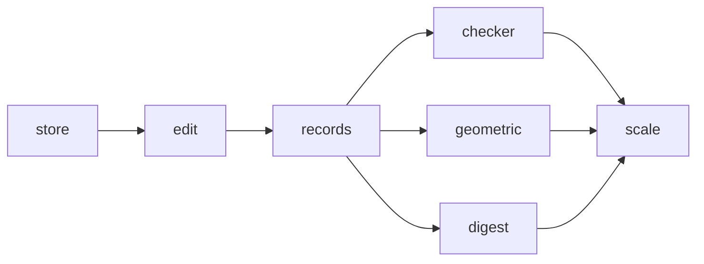

# Milestone: topology

The third milestone of [the first release](first-release.md). A new crate, `occam-topo`, holds the B-rep of
[the topology topic](../architecture/topology.md): records in copy-on-write chunks read through per-kind views, ids of
slot and generation, provenance, and `Edit`, whose `commit` runs the checker and is the only way to make a snapshot,
handing back `Changes` with each new entity's lineage. Parity rows 1.1 and 1.10.

**Exit (gate):** `just gates`, `just mutants` and `just perf` are green; the Euler and closure checks pass on every
model the tests build, and every seeded corruption is caught and named by its entities. **Exit (goal):**
[S3-P3's](../evidence/2026-11-09-s3-p3.md) snapshot and edit benchmarks at 10⁶ faces, on the real records, reported
beside the spike's numbers.

**PR grouping:** every step shares one PR, with a commit each, as for [`maths`](maths.md) and
[`geometry`](geometry.md).

**Throughout.** `occam-topo` uses `occam-report`, `occam-math`, `occam-units` and `occam-geom`, and no new dependency is
expected. Geometry is held as the seam's trait objects in `World`, never by family. Ids are given on one thread, in
`Edit` alone. The records do not freeze at the exit ([risks](../architecture/risks.md)): later milestones may add
fields. Names and colours arrive with `exchange`, and the describer and the native format with `construction`.

## Steps

Every step is done; the exit gate above is checked on the milestone's PR.
