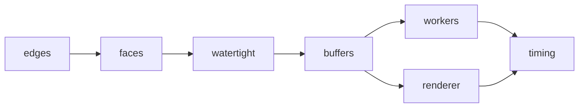

# Milestone: view

The fifth milestone of [the first release](first-release.md). A model is meshed and drawn in a browser. A new crate,
`occam-mesh`, samples each shared edge once, meshes each face against those samples, and checks every output for
watertightness. Mesh workers mesh ranges of faces from the native bytes the editing worker publishes, and a page in
`web/` draws them on the GPU. The design is [mesh and renderer](../architecture/mesh-and-renderer.md),
[the browser](../architecture/browser.md) and [determinism](../architecture/determinism.md). Parity row 1.7.

**Exit (gate):** `just gates`, `just mutants` and `just perf` are green; the watertight check passes on every mesh the
tests make, and every seeded crack is caught and named by its edge; meshes hash the same at 1 and N threads, on x86-64
and on wasm32 baseline and simd128; in headless Chromium the page draws `construction`'s exit model from the mesh
workers, with its buffers asserted. **Exit (goal):** [P9's](../evidence/2026-11-09-p9.md) quality and scaling tables on
the real mesher, and the mesh pool timed in the browser beside [P10's](../evidence/2026-11-09-p10.md).

**PR grouping:** every step shares one PR, with a commit each, as for the milestones before it.

**Throughout.** `occam-mesh` takes its place in [the layers](../PLAN.md#4-layers), std-only, computing through
`occam-math` and running in parallel only through `Exec`. Meshing [ships complete](first-release.md) as an operation
does. GPU results stay display-only ([decision](../decisions/2026-11-09-gpu-drawing.md)): never in a digest, a mesh,
the watertight check or a test that compares bits. No Rust dependency is expected beyond the allowed
[`wasm-bindgen`](../decisions/2026-11-09-wasm-bindgen.md); `js-sys` or `web-sys`, if needed, is the user's call.
`web/` expects no runtime dependency (O8), and its tests use the Playwright `gates perf` already runs. Each face is
meshed once: [view-dependent detail](../decisions/2026-11-11-view-dependent-detail-after-release.md) comes after the
release. The sketch's `mesh.rs`, then `compose.rs`'s `Session`, are deleted as they become real.

## Steps

### `view.edges`

`occam-mesh` with its limits, and every edge any face uses sampled once, as finely as the finest of its faces asks
under the deflection and angle limits. The limits come first (P9): no surface may ask an edge for a step below the
floor, no size estimate comes from a collapsed row or a pole, and each edge has a sample cap. An edge over its cap is
refused by name, with a remedy giving a deflection that fits.

*Failing test first:* a circle's samples are within the deflection of their chords; P9's bicubic patch with a collapsed
row asks for no more than the cap; an edge over its cap is named, and meshing at its remedy's deflection succeeds; the
samples are the same bits at 1 and N threads.

### `view.faces`

Each face meshed against the shared samples, one face a task. Point location uses `occam-math`'s exact predicates on
the real coordinates, not P9's integer grid, which caused all three of its failures. Refinement stops on chordal error
measured to the triangle, with a floor for conical points and a cap on triangles. Normals come from the surface, poles
included. A face that will not mesh is named with its reason, and its neighbours are unaffected. Repair names the edges
that collided, and is tried only where finer samples can cure the failure.

*Failing test first:* P9's adversarial catalogue rebuilt as models, including the edge of 1e-8 mm and the gap of
1e-7 mm that its grid failed: each meshes within its deflection, measured to the triangle; a face seeded to fail is
reported, and its neighbours still mesh.

### `view.watertight`

The faces merged by index into one vertex block per face, whose boundary positions are its edges' samples, so
neighbours hold the same bits there without welding. The watertight check runs on every output, in release builds
too: every mesh edge used twice, in opposite directions, and each closed shell's mesh with its Euler characteristic.
A failure names its open edges and their faces. Meshes join `gates determinism`.

*Failing test first:* a boundary vertex moved one ulp is caught and named by its edge; an unmeshed face shows as a
named hole; every primitive and swept solid meshes watertight; the probe's hash is the same at every thread count and
lane width.

### `view.buffers`

The mesh as [the renderer contract](../architecture/mesh-and-renderer.md#the-renderer-contract) wants it: flat arrays
of `f64` positions, unit normals and `u32` indices, with a vertex block and a triangle range per face. After an edit,
only the faces it touched and those sharing an edge whose samples changed are meshed again; the rest keep their blocks
bit for bit. `occam mesh` writes them, with a `--json` summary, and `occam-wasm` exposes the same.

*Failing test first:* a cube's and a cylinder's buffers are asserted (counts, strides, per-face ranges, indices in
range); adding a second primitive leaves the first's blocks unchanged and unmeshed; `occam mesh --json` gives one
result per face.

### `view.workers`

`occam`'s `Session` made real and wrapped by `occam-wasm`. One editing worker holds the model, runs requests and
publishes the binary twin after each edit. A pool of mesh workers, kept alive between requests, each loads its own
copy and meshes ranges of faces, about 64 calls a job, transferring flat arrays back. No wasm runs on the page's main
thread, and the page needs no COOP or COEP headers.

*Failing test first:* in headless Chromium, a request run in the editing worker is meshed by four workers to the
native mesher's hash; a failing face is named and the rest arrive; the main thread never loads the module.

### `view.renderer`

`web/`, the viewer: a page that draws the per-face buffers with the API O19 picks. Its buffers can be read by both a
storage binding and a vertex fetch, coordinates are `f32` offsets from an `f64` origin the page keeps, uploads are
bounded per frame, and the frame loop keeps submitting during interaction. It orbits, pans and zooms; it does not
pick. CI has no GPU, so its tests run on headless Chromium's software adapter and assert buffers, not pixels.

*Failing test first:* the page draws a cube, and the buffers it uploaded match the mesh, offsets within `f32` of the
`f64` positions; a model over the per-frame bound is uploaded in pieces; a face edited away disappears without the
others being uploaded again.

### `view.timing`

The exit's measurements: the mesher's classes in `gates perf`, scalar and lanes, with browser timing; P9's quality
table on the real mesher (deviation over deflection, triangles over the angular limit, smallest angles) for its 1,002
and 10,001-face models; the native speed-up at 1 to 6 threads; and the pool in the browser at 1 to 6 workers, cold and
warm. The editing worker's longest call on `construction`'s requests is recorded too, which
[the browser topic](../architecture/browser.md) waits on before splitting a boolean across calls.

*Failing test first:* each new class is `perf.unrecorded` until the record takes it; the mesher's lane kernel fails
the vectorisation check until it beats width 1.

## Open questions for the user

Four decisions in [the plan's §7](../PLAN.md#7-decisions-the-user-still-owns) are due here, each recommended there:
O19, which browsers, and so WebGPU or WebGL2, needed before `view.renderer`; O8, a framework for the page; O20,
continuous editing of whole very large faces; and O28, picking in the viewer.
