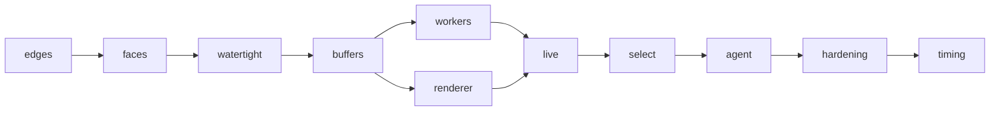

# Milestone: view

The fifth milestone of [the first release](first-release.md). A person prompts an agent, the agent builds with the
`occam` command, and a page shows the model live as each run saves it
([decision](../decisions/2026-11-14-prompt-driven-building-shown-live.md)). A new crate, `occam-mesh`, samples each
shared edge once, meshes each face against those samples, and checks every output for watertightness. Mesh workers mesh
ranges of faces from the native bytes the editing worker publishes. A page in `web/` draws them with
[WebGPU](../decisions/2026-11-13-webgpu-on-chromium-and-firefox.md), and `occam view` serves it and redraws it on every
change. The person [picks](../decisions/2026-11-13-picking-in-the-first-release.md) faces and edges to select them,
and the agent reads the selection and highlights what it will change. The design is [the live
view](../architecture/live-view.md), [mesh and renderer](../architecture/mesh-and-renderer.md), [the
browser](../architecture/browser.md) and [determinism](../architecture/determinism.md). Parity row 1.7.

**Exit (gate):** `just gates`, `just mutants` and `just perf` are green. The watertight check passes on every mesh the
tests make, and every seeded crack is caught and named by its edge. Meshes and picks are the same at 1 and N threads, on
x86-64 and on wasm32 baseline and simd128. In headless Chromium, against `occam view`:

- the page draws `construction`'s exit model from the mesh workers, with its buffers asserted;
- an `occam run` that adds a body reaches the page, which meshes only the new faces;
- a click on a face, and one on an edge, give the ids `occam pick` gives for the same rays; `occam selection` then
  describes what was clicked; and an `occam highlight` shows in the page;
- the agent test passes when its recipe runs on the first PR, its log kept as evidence: an agent on the cheapest model
  the blind runs used starts `occam view`, builds a part from a prompt, the page following each run, and acts on a face
  selected as a person would.

**Exit (goal):** [P9's](../evidence/2026-11-09-p9.md) quality and scaling tables on the real mesher; the mesh pool timed
in the browser beside [P10's](../evidence/2026-11-09-p10.md); the time from a run's save to the page's redraw; and a
pick timed on real GPUs in Chromium and Firefox within 16.7 ms on P9's 10,001-face model, a
[goal](../decisions/2026-11-13-gpu-figures-are-goals.md) no measurement grounds.
[Write-through](../decisions/2026-11-14-write-through-after-the-first-release.md) and its figures wait for the editing
tools.

**PR grouping:** two PRs, with a commit a step. The first ends at `view.agent`, so the live demo reaches `main` as soon
as it works; the second holds `view.hardening` and `view.timing`, and closes the milestone.

**Throughout.** `occam-mesh` takes its place in [the layers](../PLAN.md#4-layers), std-only, computing through
`occam-math` and running in parallel only through `Exec`. Meshing [ships complete](first-release.md) as an operation
does. GPU results stay display-only ([decision](../decisions/2026-11-09-gpu-drawing.md)):
never in a digest, a mesh, a pick, the watertight check, or a test that holds them to recorded bits. The Rust dependencies
are the allowed [`wasm-bindgen`](../decisions/2026-11-09-wasm-bindgen.md), and [`axum` and
`tokio`](../decisions/2026-11-14-axum-and-tokio-for-the-viewer.md), with `futures-util`, in `occam-cli` for
`occam view`; `js-sys` or `web-sys`, if needed, is the user's call.
`web/` is built with [Preact and signals](../decisions/2026-11-13-preact-with-signals.md), which the full web
application grows from, and is written in
[TypeScript, typed against WebGPU](../decisions/2026-11-13-typescript-with-webgpu-types.md): esbuild builds it and
`tsc --noEmit` checks it in the gates. `view.renderer` adds them, esbuild, `typescript` and `@webgpu/types` at pinned
versions, asking for each again under the dependency rule. `web/`'s tests use the Playwright `gates perf` already
runs. Each face is meshed once: [view-dependent
detail](../decisions/2026-11-11-view-dependent-detail-after-release.md) comes after the release. The sketch's `mesh.rs`,
then `compose.rs`'s `Session`, are deleted as they become real.

## Steps

### `view.faces`

Each face meshed against the shared samples, one face a task. Point location uses `occam-math`'s exact predicates on
the real coordinates, not P9's integer grid, which caused all three of its failures. Refinement stops on chordal error
measured to the triangle, with a floor for conical points and a cap on triangles. Normals come from the surface, poles
included. A face that will not mesh is named with its reason, and its neighbours are unaffected. P9's adversarial
cases and repair wait for `view.hardening`, after the demo.

*Failing test first:* every face `construction` makes (planes with holes, and the sides and caps of each primitive,
extrusion and revolve) meshes within its deflection, measured to the triangle; a face seeded to fail is reported, and
its neighbours still mesh.

### `view.watertight`

The faces merged by index into one vertex block per face, whose boundary positions are its edges' samples, so
neighbours hold the same bits there without welding. The watertight check runs on every output, in release builds
too: every mesh edge used twice, in opposite directions, and each closed shell's mesh with its Euler characteristic.
A failure names its open edges and their faces. Meshes join `gates determinism`.

*Failing test first:* a boundary vertex moved one ulp is caught and named by its edge; an unmeshed face shows as a
named hole; every primitive and swept solid meshes watertight; the probe's hash is the same at every thread count and
lane width.

### `view.buffers`

The mesh as [the renderer contract](../architecture/mesh-and-renderer.md#the-renderer-contract) wants it: flat arrays of
`f64` positions, unit normals, each vertex's `(u, v)` on its face (kept for [write-through](../decisions/2026-11-14-write-through-after-the-first-release.md)) and `u32` indices,
with a vertex block and a triangle range per face. After an edit, only the faces it touched and those sharing an edge
whose samples changed are meshed again; the rest keep their blocks bit for bit. `occam mesh` writes them, with a
`--json` summary, and `occam-wasm` exposes the same.

*Failing test first:* a cube's and a cylinder's buffers are asserted (counts, strides, per-face ranges, indices in
range, and each vertex within the band of its face's surface at its `(u, v)`); adding a second primitive leaves the
first's blocks unchanged and unmeshed; `occam mesh --json` gives one result per face.

### `view.workers`

`occam`'s `Session` made real and wrapped by `occam-wasm`. One editing worker holds the model, runs requests and
publishes the binary twin after each edit. A pool of mesh workers, kept alive between requests, each loads its own
copy and meshes ranges of faces, about 64 calls a job, transferring flat arrays back. No wasm runs on the page's main
thread, and the page needs no COOP or COEP headers.

*Failing test first:* in headless Chromium, a request run in the editing worker is meshed by four workers to the
native mesher's hash; a failing face is named and the rest arrive; the main thread never loads the module.

### `view.renderer`

`web/`, the viewer: a page that draws the per-face buffers with WebGPU. Its buffers can be read by both a storage
binding and a vertex fetch, coordinates are `f32` offsets from an `f64` origin the page keeps, uploads are bounded per
frame, and the frame loop keeps submitting during interaction. It orbits, pans and zooms, centres on the selection and
fits the model to the window. Preact draws the controls and
signals carry their state; the frame loop and the GPU work stay outside the component tree. A browser without WebGPU
gets a named report with its remedy. CI has no GPU, so its tests run on headless Chromium's software adapter and assert
buffers, not pixels.

*Failing test first:* the page draws a cube, and the buffers it uploaded match the mesh, offsets within `f32` of the
`f64` positions; a model over the per-frame bound is uploaded in pieces; a face edited away disappears without the
others being uploaded again; fit leaves every vertex inside the view; a page denied WebGPU shows the report, not a
blank canvas.

### `view.live`

`occam view --model part.occam`: [the live view's server](../architecture/live-view.md#the-server), in `occam-cli`, on axum
and tokio. [The agent starts it](../decisions/2026-11-14-the-agent-starts-the-viewer.md): the command starts the
server as a process of its own, prints the page's address and returns, and a state file beside the model keeps one
server per model; `--status` and `--stop` answer for it, and it stops itself when no page has been open for an hour.
It serves the page with its built files inside the binary, on `127.0.0.1` behind a token, sends the model as the
binary twin, and polls the model file, sending the page an event with the new digest when a change reads whole. The
page fetches the model again and meshes only the faces that changed. A file that is not a model, or vanishes, is a
named report in the page and on the command line, and the server keeps watching. A recipe builds the page into the
directory the binary embeds; a plain `cargo build` embeds a stub page that names the recipe.

*Failing test first:* in headless Chromium against `occam view`, the page draws a model; an `occam run` that adds a
cylinder reaches the page, which meshes only the cylinder's faces; a half-written file is not drawn; a request without
the token is refused; a model file replaced by garbage gives the report and the last good model stays drawn. On the
command line, `occam view` returns once the server listens; a second `occam view` on the same model prints the same
address and starts nothing; `--stop` stops it and `--status` then says none runs; a state file left by a killed server
is replaced; and a build without the recipe serves the stub page.

### `view.select`

`occam-mesh` picks against the CPU mesh, never GPU output. A ray, built in `f64` from the page's origin and camera, is
tested against each face's triangles through a box tree built with the mesh, and against each edge's samples within a
tolerance the caller gives; the page gives a few pixels at the hit's depth. The nearest hit gives its id, an edge
winning over its faces within the tolerance, and ties go to the smaller id. `occam pick --json` and `occam-wasm` expose
it. A ray that hits nothing answers no id, with the reason.

In the page, a click picks in a mesh worker and selects what it hit; shift-click adds or removes. The page posts the
selection to `occam view`, which writes [the selection file](../architecture/live-view.md#the-selection-file).
`occam selection` describes it, or calls it stale with a remedy. `occam highlight` writes the highlight file, and the
page draws those ids in a second colour. `occam run` carries the selection over through its changes and clears the
highlight.

*Failing test first:* a ray through the centre of each face of a cube picks that face; a ray within the tolerance of an
edge picks the edge, and one just beyond it the face; the same rays give the same ids at 1 and N threads and on wasm32;
from JSON alone, an agent test builds `construction`'s exit model, picks the cylinder's side with `occam pick`, and
`occam describe` of the answer says a cylinder of radius 4. In headless Chromium a click at that face's projected
centre selects the same id, the pick path maps no GPU buffer, and `occam selection` describes it. A run that copies
the selected body leaves the selection on the original; a run that deletes it drops it and says so; a selection posted
for an older model is refused; a highlight shows and a run clears it.

### `view.agent`

The demo, made a test. A first occam skill, `skills/occam/SKILL.md`, tells an agent what the command's guide does not:
start `occam view` and tell the person where to look, build in runs it can check, read `occam selection` when the
person says "the selected", highlight before changing what is selected, measure to confirm, and stop the viewer when
the person is done. It serves Claude Code first: the binary carries it, and `occam skill --install` copies it into the
project's `.claude/skills/` ([decision](../decisions/2026-11-14-the-agent-starts-the-viewer.md)). The skill is held to
the commands by a test that runs every example in it.

*Failing test first:* an agent on the cheapest model the blind runs used, given the skill and a prompt for a plate with
a hole, starts `occam view` and builds the plate through `occam run` while headless Chromium follows each run; the test
then selects the plate's top face through the page and prompts "stand a cylinder of radius 5 and height 20 on the
centre of the selected face"; the agent reads the selection, highlights it, and runs; the cylinder's base lies on that
face, within the band. The agent is headless Claude Code, resumed for the second prompt, with the model pinned and a
cap on its calls, run by a recipe on the person's own key: once on the first PR, its log kept as evidence, as in
[the construction blind run](../evidence/2026-11-13-construction-blind-run.md). The same steps with the agent's calls
scripted run in CI. Rounding an edge waits for `blends`, and adding material to a solid's face for `booleans`.

### `view.hardening`

The mesher held against [P9's](../evidence/2026-11-09-p9.md) adversarial catalogue. Repair names the edges that
collided, and is tried only where finer samples can cure the failure.

*Failing test first:* P9's adversarial catalogue rebuilt as models, including the edge of 1e-8 mm and the gap of
1e-7 mm that its grid failed: each meshes within its deflection, measured to the triangle, or is named with its reason;
repair cures the cases finer samples can, and names the rest.

### `view.timing`

The exit's measurements: the mesher's classes in `gates perf`, scalar and lanes, with browser timing; P9's quality
table on the real mesher (deviation over deflection, triangles over the angular limit, smallest angles) for its 1,002
and 10,001-face models; the native speed-up at 1 to 6 threads; and the pool in the browser at 1 to 6 workers, cold and
warm. The editing worker's longest call on `construction`'s requests is recorded too, which
[the browser topic](../architecture/browser.md) waits on before splitting a boolean across calls, and so is the time
from a run's save to the page's redraw.

A pick is timed on real GPUs, the measuring machine's discrete one and the laptop's integrated one, in Chromium and
Firefox, on P9's 10,001-face model. Chromium runs headed if headless reaches only a software adapter. The figure is a
[goal](../decisions/2026-11-13-gpu-figures-are-goals.md), recorded in the PR; its 16.7 ms is a target no measurement
grounds.

*Failing test first:* each new class is `perf.unrecorded` until the record takes it; the mesher's lane kernel fails
the vectorisation check until it beats width 1; the GPU timing script refuses a run on a software adapter.

## Open questions for the user

None is open. The six of [the plan's §7](../PLAN.md#7-decisions-the-user-still-owns) due here are answered:
[O8](../decisions/2026-11-13-preact-with-signals.md), [O19](../decisions/2026-11-13-webgpu-on-chromium-and-firefox.md),
[O20](../decisions/2026-11-13-write-through-in-the-first-release.md), since
[moved after the first release](../decisions/2026-11-14-write-through-after-the-first-release.md),
[O28](../decisions/2026-11-13-picking-in-the-first-release.md),
[O29](../decisions/2026-11-13-continuous-edits-rerun-the-request.md), which moves with write-through, and
[O30](../decisions/2026-11-13-gpu-figures-are-goals.md). The live view follows
[prompt-driven building](../decisions/2026-11-14-prompt-driven-building-shown-live.md), [the agent starts
the viewer](../decisions/2026-11-14-the-agent-starts-the-viewer.md), and `occam view` uses
[axum and tokio](../decisions/2026-11-14-axum-and-tokio-for-the-viewer.md). `view.renderer`'s PR still asks for its npm packages,
esbuild and the [TypeScript checker](../decisions/2026-11-13-typescript-with-webgpu-types.md) under the
dependency rule.