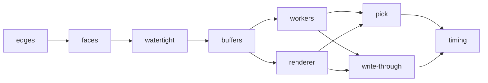

# Milestone: view

The fifth milestone of [the first release](first-release.md). A model is meshed and drawn in a browser. A new crate,
`occam-mesh`, samples each shared edge once, meshes each face against those samples, and checks every output for
watertightness. Mesh workers mesh ranges of faces from the native bytes the editing worker publishes. A page in `web/`
draws them with [WebGPU](../decisions/2026-11-13-webgpu-on-chromium-and-firefox.md),
[picks](../decisions/2026-11-13-picking-in-the-first-release.md) faces and edges by id against the CPU mesh, and lets
the GPU write the display of faces under a
[continuous edit](../decisions/2026-11-13-write-through-in-the-first-release.md). The design is
[mesh and renderer](../architecture/mesh-and-renderer.md), [the browser](../architecture/browser.md) and
[determinism](../architecture/determinism.md). Parity row 1.7.

**Exit (gate):** `just gates`, `just mutants` and `just perf` are green. The watertight check passes on every mesh the
tests make, and every seeded crack is caught and named by its edge. Meshes and picks are the same at 1 and N threads, on
x86-64 and on wasm32 baseline and simd128. In headless Chromium:

- the page draws `construction`'s exit model from the mesh workers, with its buffers asserted;
- a click on a face, and one on an edge, give the ids `occam pick` gives for the same rays, and `occam describe` of each
  names what was clicked;
- on the software adapter, write-through's positions are within 1e-6 of the part's size of the `f64` surface;
  neighbours hold the same bits along their shared edge; the index buffer does not change during an edit; and the mesh
  hash is the same with write-through on and off.

**Exit (goal):** [P9's](../evidence/2026-11-09-p9.md) quality and scaling tables on the real mesher; the mesh pool timed
in the browser beside [P10's](../evidence/2026-11-09-p10.md); and write-through and picking timed on real GPUs in
Chromium and Firefox, as [goals](../decisions/2026-11-13-gpu-figures-are-goals.md): 60 Hz with a whole face re-evaluated
every frame at 1,000,000 and 4,000,000 points on a discrete GPU and 1,000,000 on an integrated one, under 1 ms a frame
on the main thread, and a pick within 16.7 ms on P9's 10,001-face model, a target no measurement grounds.

**PR grouping:** every step shares one PR, with a commit each, as for the milestones before it.

**Throughout.** `occam-mesh` takes its place in [the layers](../PLAN.md#4-layers), std-only, computing through
`occam-math` and running in parallel only through `Exec`. Meshing [ships complete](first-release.md) as an operation
does. GPU results stay display-only ([decision](../decisions/2026-11-09-gpu-drawing.md)), write-through's included:
never in a digest, a mesh, a pick, the watertight check, or a test that holds them to recorded bits. Write-through's
crack test compares two faces' GPU positions with each other, in one frame. No Rust dependency is expected beyond the
allowed [`wasm-bindgen`](../decisions/2026-11-09-wasm-bindgen.md); `js-sys` or `web-sys`, if needed, is the user's call.
`web/` is built with [Preact and signals](../decisions/2026-11-13-preact-with-signals.md), which the full web
application grows from. `view.renderer` adds them and esbuild at pinned versions, asking for each again under the
dependency rule. `web/`'s tests use the Playwright `gates perf` already runs. Each face is meshed once: [view-dependent
detail](../decisions/2026-11-11-view-dependent-detail-after-release.md) comes after the release. The sketch's `mesh.rs`,
then `compose.rs`'s `Session`, are deleted as they become real.

## Steps

### `view.edges`

`occam-mesh` with its limits, and every edge any face uses sampled once, as finely as the finest of its faces asks
under the deflection and angle limits. The limits come first (P9): no surface may ask an edge for a step below the
floor, no size estimate comes from a collapsed row or a pole, and each edge has a sample cap. An edge over its cap is
refused by name, with a remedy giving a deflection that fits.

*Failing test first:* a circle's samples are within the deflection of their chords; P9's bicubic patch with a collapsed
row asks for no more than the cap; an edge over its cap is named, and meshing at its remedy's deflection succeeds; the
samples are the same bits at 1 and N threads.

### `view.faces`

Each face meshed against the shared samples, one face a task. Point location uses `occam-math`'s exact predicates on
the real coordinates, not P9's integer grid, which caused all three of its failures. Refinement stops on chordal error
measured to the triangle, with a floor for conical points and a cap on triangles. Normals come from the surface, poles
included. A face that will not mesh is named with its reason, and its neighbours are unaffected. Repair names the edges
that collided, and is tried only where finer samples can cure the failure.

*Failing test first:* P9's adversarial catalogue rebuilt as models, including the edge of 1e-8 mm and the gap of
1e-7 mm that its grid failed: each meshes within its deflection, measured to the triangle; a face seeded to fail is
reported, and its neighbours still mesh.

### `view.watertight`

The faces merged by index into one vertex block per face, whose boundary positions are its edges' samples, so
neighbours hold the same bits there without welding. The watertight check runs on every output, in release builds
too: every mesh edge used twice, in opposite directions, and each closed shell's mesh with its Euler characteristic.
A failure names its open edges and their faces. Meshes join `gates determinism`.

*Failing test first:* a boundary vertex moved one ulp is caught and named by its edge; an unmeshed face shows as a
named hole; every primitive and swept solid meshes watertight; the probe's hash is the same at every thread count and
lane width.

### `view.buffers`

The mesh as [the renderer contract](../architecture/mesh-and-renderer.md#the-renderer-contract) wants it: flat arrays of
`f64` positions, unit normals, each vertex's `(u, v)` on its face (write-through evaluates there) and `u32` indices,
with a vertex block and a triangle range per face. After an edit, only the faces it touched and those sharing an edge
whose samples changed are meshed again; the rest keep their blocks bit for bit. `occam mesh` writes them, with a
`--json` summary, and `occam-wasm` exposes the same.

*Failing test first:* a cube's and a cylinder's buffers are asserted (counts, strides, per-face ranges, indices in
range, and each vertex within the band of its face's surface at its `(u, v)`); adding a second primitive leaves the
first's blocks unchanged and unmeshed; `occam mesh --json` gives one result per face.

### `view.workers`

`occam`'s `Session` made real and wrapped by `occam-wasm`. One editing worker holds the model, runs requests and
publishes the binary twin after each edit. A pool of mesh workers, kept alive between requests, each loads its own
copy and meshes ranges of faces, about 64 calls a job, transferring flat arrays back. No wasm runs on the page's main
thread, and the page needs no COOP or COEP headers.

*Failing test first:* in headless Chromium, a request run in the editing worker is meshed by four workers to the
native mesher's hash; a failing face is named and the rest arrive; the main thread never loads the module.

### `view.renderer`

`web/`, the viewer: a page that draws the per-face buffers with WebGPU. Its buffers can be read by both a storage
binding and a vertex fetch, coordinates are `f32` offsets from an `f64` origin the page keeps, uploads are bounded per
frame, and the frame loop keeps submitting during interaction. It orbits, pans and zooms. Preact draws the controls and
signals carry their state; the frame loop and the GPU work stay outside the component tree. A browser without WebGPU
gets a named report with its remedy. CI has no GPU, so its tests run on headless Chromium's software adapter and assert
buffers, not pixels.

*Failing test first:* the page draws a cube, and the buffers it uploaded match the mesh, offsets within `f32` of the
`f64` positions; a model over the per-frame bound is uploaded in pieces; a face edited away disappears without the
others being uploaded again; a page denied WebGPU shows the report, not a blank canvas.

### `view.pick`

`occam-mesh` picks against the CPU mesh, never GPU output. A ray, built in `f64` from the page's origin and camera, is
tested against each face's triangles through a box tree built with the mesh, and against each edge's samples within a
tolerance the caller gives; the page gives a few pixels at the hit's depth. The nearest hit gives its id, an edge
winning over its faces within the tolerance, and ties go to the smaller id. `occam pick --json` and `occam-wasm` expose
it. In the page, a click goes to a mesh worker and comes back as JSON with the id and the point hit, and the page shows
the id. A ray that hits nothing answers no id, with the reason.

*Failing test first:* a ray through the centre of each face of a cube picks that face; a ray within the tolerance of an
edge picks the edge, and one just beyond it the face; the same rays give the same ids at 1 and N threads and on wasm32;
from JSON alone, an agent test builds `construction`'s exit model, picks the cylinder's side with `occam pick`, and
`occam describe` of the answer says a cylinder of radius 4; in headless Chromium a click at that face's projected centre
gives the same id, and the pick path maps no GPU buffer.

### `view.write-through`

During a continuous edit, the GPU writes the display of each face the edit changes:
[P12's](../evidence/2026-11-09-p12.md) compute write-through, drawn and never read back. Each frame the page uploads the
touched faces' new surfaces as rational B-splines, their control points offsets from its `f64` origin. Families with an
exact B-spline form get there through `to_bspline` over the face's range; the others update on the CPU. An edge pass
evaluates each shared edge once. A WGSL shader then evaluates each face at its CPU mesh's own `(u, v)`, mapped onto the
face's new parameter box if that moved, and reads its boundary from the edges. Trims, triangles and the index buffer
therefore stay as they are. When the edit stops, the touched faces are meshed again and their CPU blocks replace the
GPU's. Uploads keep P12's bounds: vertex data in calls of at most 2 MiB, indices in 16 MiB, and a wait for the GPU after
each 64 MiB. Each frame's surfaces come from [re-running the edit's
request](../decisions/2026-11-13-continuous-edits-rerun-the-request.md) in the editing worker, from the snapshot before
the edit, committed with its checks and meshed only when the edit stops.

*Failing test first:* a request whose number changes every frame is re-run from the snapshot before the edit, and every
frame's commit passes its checks. On the software adapter, reading back for the test only, a face is streamed for 60
frames. Its index buffer and per-face ranges stay the same byte for byte. Its positions are within 1e-6 of the part's
size of the `f64` surface at the same parameters, at offsets of up to 10⁷ part sizes from the origin (P12 measured
2.1e-7 to 2.8e-7). The two faces at a shared edge hold the same bits there every frame (P12: 0 of 501 differ). A
1,000,000-point face's first fill goes in bounded pieces, and the page submits every frame during the edit. When the
edit stops, the drawn blocks equal the CPU mesh's, and the mesh hash is the same as with write-through off.

### `view.timing`

The exit's measurements: the mesher's classes in `gates perf`, scalar and lanes, with browser timing; P9's quality
table on the real mesher (deviation over deflection, triangles over the angular limit, smallest angles) for its 1,002
and 10,001-face models; the native speed-up at 1 to 6 threads; and the pool in the browser at 1 to 6 workers, cold and
warm. The editing worker's longest call on `construction`'s requests is recorded too, which
[the browser topic](../architecture/browser.md) waits on before splitting a boolean across calls.

Write-through and picking are timed on real GPUs, the measuring machine's discrete one and the laptop's integrated one,
in Chromium and Firefox. Chromium runs headed if headless reaches only a software adapter. Write-through is measured
with P12's measures and its 60 Hz rule (median frame at most 17.5 ms, 95th percentile at most 25 ms), with a whole face
re-evaluated every frame at 1,000,000 and 4,000,000 points. These runs add what P12 left out: trims, per-face dispatch
on a many-face model, rational surfaces, and the editing worker's time per frame. A pick is timed on P9's 10,001-face
model. These figures are [goals](../decisions/2026-11-13-gpu-figures-are-goals.md), recorded in the PR; the pick's 16.7
ms is a target no measurement grounds.

*Failing test first:* each new class is `perf.unrecorded` until the record takes it; the mesher's lane kernel fails
the vectorisation check until it beats width 1; the GPU timing script refuses a run on a software adapter.

## Open questions for the user

None is open. The six of [the plan's §7](../PLAN.md#7-decisions-the-user-still-owns) due here are answered:
[O8](../decisions/2026-11-13-preact-with-signals.md), [O19](../decisions/2026-11-13-webgpu-on-chromium-and-firefox.md),
[O20](../decisions/2026-11-13-write-through-in-the-first-release.md),
[O28](../decisions/2026-11-13-picking-in-the-first-release.md),
[O29](../decisions/2026-11-13-continuous-edits-rerun-the-request.md) and
[O30](../decisions/2026-11-13-gpu-figures-are-goals.md). `view.renderer`'s PR still asks for its npm packages and
esbuild under the dependency rule.