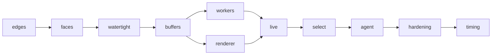

# Milestone: view

The fifth milestone of [the first release](first-release.md). A person prompts an agent, the agent builds with the
`occam` command, and a page shows the model live as each run saves it
([decision](../decisions/2026-11-14-prompt-driven-building-shown-live.md)). A new crate, `occam-mesh`, samples each
shared edge once, meshes each face against those samples, and checks every output for watertightness. Mesh workers mesh
ranges of faces from the native bytes the editing worker publishes. A page in `web/` draws them with
[WebGPU](../decisions/2026-11-13-webgpu-on-chromium-and-firefox.md), and `occam view` serves it and redraws it on every
change. The person [picks](../decisions/2026-11-13-picking-in-the-first-release.md) faces and edges to select them,
and the agent reads the selection and highlights what it will change. The design is [the live
view](../architecture/live-view.md), [mesh and renderer](../architecture/mesh-and-renderer.md), [the
browser](../architecture/browser.md) and [determinism](../architecture/determinism.md). Parity row 1.7.

**Exit (gate):** `just gates`, `just mutants` and `just perf` are green. The watertight check passes on every mesh the
tests make, and every seeded crack is caught and named by its edge. Meshes and picks are the same at 1 and N threads, on
x86-64 and on wasm32 baseline and simd128. In headless Chromium, against `occam view`:

- the page draws `construction`'s exit model from the mesh workers, with its buffers asserted;
- an `occam run` that adds a body reaches the page, which meshes only the new faces;
- a click on a face, and one on an edge, give the ids `occam pick` gives for the same rays; `occam selection` then
  describes what was clicked; and an `occam highlight` shows in the page;
- the agent test passes when its recipe runs on `view.agent`'s PR, its log kept as evidence: an agent on the cheapest
  model the blind runs used starts `occam view`, builds a part from a prompt, the page following each run, and acts on a face
  selected as a person would.

**Exit (goal):** [P9's](../evidence/2026-11-09-p9.md) quality and scaling tables on the real mesher; the mesh pool timed
in the browser beside [P10's](../evidence/2026-11-09-p10.md); the time from a run's save to the page's redraw; and a
pick timed on real GPUs in Chromium and Firefox within 16.7 ms on P9's 10,001-face model, a
[goal](../decisions/2026-11-13-gpu-figures-are-goals.md) no measurement grounds.
[Write-through](../decisions/2026-11-14-write-through-after-the-first-release.md) and its figures wait for the editing
tools.

**PR grouping:** a step merges in its own PR ([decision](../decisions/2026-11-15-view-merges-a-step-a-pr.md)). The
live demo reaches `main` with `view.agent`'s.

**Throughout.** `occam-mesh` takes its place in [the layers](../PLAN.md#4-layers), std-only, computing through
`occam-math` and running in parallel only through `Exec`. Meshing [ships complete](first-release.md) as an operation
does. GPU results stay display-only ([decision](../decisions/2026-11-09-gpu-drawing.md)):
never in a digest, a mesh, a pick, the watertight check, or a test that holds them to recorded bits. The Rust dependencies
are the allowed [`wasm-bindgen`](../decisions/2026-11-09-wasm-bindgen.md), and [`axum` and
`tokio`](../decisions/2026-11-14-axum-and-tokio-for-the-viewer.md), with `futures-util`, in `occam-cli` for
`occam view`; `js-sys` or `web-sys`, if needed, is the user's call.
`web/` is built with [Preact and signals](../decisions/2026-11-13-preact-with-signals.md), which the full web
application grows from, and is written in
[TypeScript, typed against WebGPU](../decisions/2026-11-13-typescript-with-webgpu-types.md): esbuild builds it and
`tsc --noEmit` checks it in the gates. `web/` pins them, esbuild, `typescript` and `@types/web`, each
[approved](../decisions/2026-11-15-the-viewers-npm-packages.md) under the dependency rule. `web/`'s tests use the
Playwright `gates perf` already runs. Each face is meshed once: [view-dependent
detail](../decisions/2026-11-11-view-dependent-detail-after-release.md) comes after the release.

## Steps

### `view.hardening`

The mesher held against [P9's](../evidence/2026-11-09-p9.md) adversarial catalogue. Repair names the edges that
collided, and is tried only where finer samples can cure the failure.

*Failing test first:* P9's adversarial catalogue rebuilt as models, including the edge of 1e-8 mm and the gap of
1e-7 mm that its grid failed: each meshes within its deflection, measured to the triangle, or is named with its reason;
repair cures the cases finer samples can, and names the rest.

### `view.timing`

The exit's measurements: the mesher's classes in `gates perf`, scalar and lanes, with browser timing; P9's quality
table on the real mesher (deviation over deflection, triangles over the angular limit, smallest angles) for its 1,002
and 10,001-face models; the native speed-up at 1 to 6 threads; and the pool in the browser at 1 to 6 workers, cold and
warm. The editing worker's longest call on `construction`'s requests is recorded too, which
[the browser topic](../architecture/browser.md) waits on before splitting a boolean across calls, and so is the time
from a run's save to the page's redraw.

A pick is timed on real GPUs, the measuring machine's discrete one and the laptop's integrated one, in Chromium and
Firefox, on P9's 10,001-face model. Chromium runs headed if headless reaches only a software adapter. The figure is a
[goal](../decisions/2026-11-13-gpu-figures-are-goals.md), recorded in the PR; its 16.7 ms is a target no measurement
grounds.

*Failing test first:* each new class is `perf.unrecorded` until the record takes it; the mesher's lane kernel fails
the vectorisation check until it beats width 1; the GPU timing script refuses a run on a software adapter.

## Open questions for the user

None is open. The six of [the plan's §7](../PLAN.md#7-decisions-the-user-still-owns) due here are answered:
[O8](../decisions/2026-11-13-preact-with-signals.md), [O19](../decisions/2026-11-13-webgpu-on-chromium-and-firefox.md),
[O20](../decisions/2026-11-13-write-through-in-the-first-release.md), since
[moved after the first release](../decisions/2026-11-14-write-through-after-the-first-release.md),
[O28](../decisions/2026-11-13-picking-in-the-first-release.md),
[O29](../decisions/2026-11-13-continuous-edits-rerun-the-request.md), which moves with write-through, and
[O30](../decisions/2026-11-13-gpu-figures-are-goals.md). The live view follows
[prompt-driven building](../decisions/2026-11-14-prompt-driven-building-shown-live.md), [the agent starts
the viewer](../decisions/2026-11-14-the-agent-starts-the-viewer.md), and `occam view` uses
[axum and tokio](../decisions/2026-11-14-axum-and-tokio-for-the-viewer.md). The page's npm packages, esbuild and the
[TypeScript checker](../decisions/2026-11-13-typescript-with-webgpu-types.md) were
[approved](../decisions/2026-11-15-the-viewers-npm-packages.md) under the dependency rule.